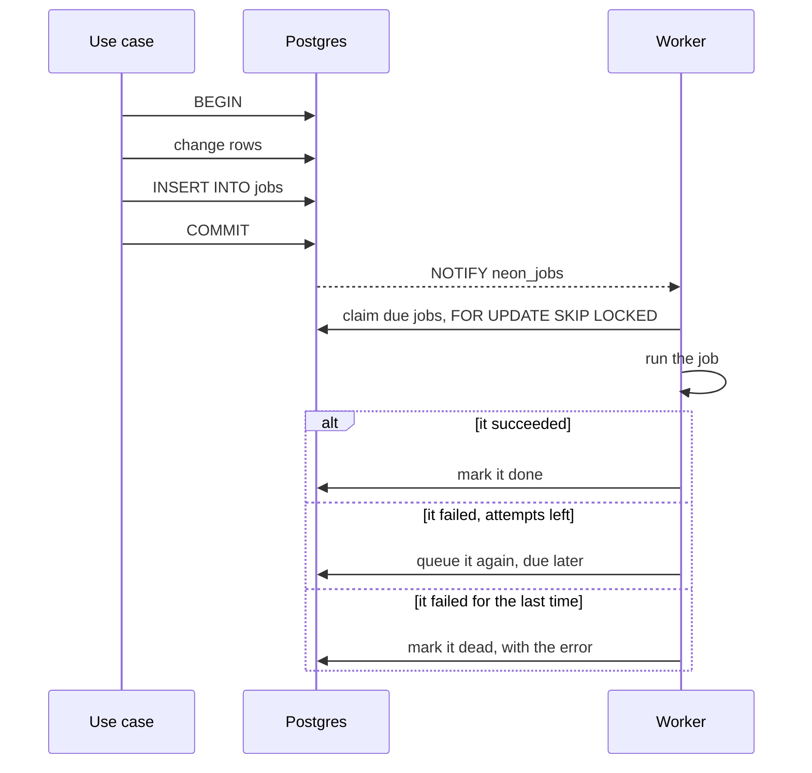

Everything Neon Teamspace keeps lasting is in one Postgres 18 database: settings, the job
queue, accounts, sessions, invites, workspaces with their members, teamspaces, invitations
and invite links, and, as it arrives, their content. There is no
cache server and no message broker beside it. Attachments are the one exception, **planned**:
they go to local disk or an S3-compatible store, as files are better kept outside the
database.

## Postgres

The server keeps one connection pool, sized by `database.max_connections`, and shares it
between the HTTP handlers and the job queue's workers. The job worker holds one more
connection of its own, outside the pool, to listen for new jobs. The pool's connections, idle
and in use, are gauges on `/metrics`, and `/readyz` pings the database through the pool; see
[Observability](/docs/architecture/observability/#gauges). Work that must happen together runs in
one transaction. A use case in `neon-app` opens it and passes it, as `&mut Transaction`, to
each repository it calls in `neon-store`, so what commits together is decided in one place,
the use case, and never inside a repository.

## Queries

SQL is written by hand, in the repositories of `neon-store`, with sqlx's `query!` and
`query_as!` macros. As the crate compiles, each macro sends its query to Postgres to be
prepared, and the compiler gets back the types of its parameters and columns. A query that
names a column that is gone, compares a `uuid` with `text`, or reads a nullable column into a
type that cannot be null does not compile.

The answers are kept in `.sqlx/`, one file per query, committed with the code. Builds use
them instead of a database when `SQLX_OFFLINE=true` is set, or when `DATABASE_URL` is not, so
a fresh checkout builds with no Postgres running. After a query changes, with the database
running and migrated:

```sh
cargo sqlx prepare --workspace
```

rewrites the cache, and `cargo sqlx prepare --workspace --check` fails when the committed
cache no longer matches the queries.

There is no ORM and no query builder. A query reads as the SQL that runs, and features such
as `FOR UPDATE SKIP LOCKED`, `jsonb` operators and full-text search are used directly.

## Migrations

The schema is built by migrations, plain SQL files in `migrations/`, one per change, named
by the time they were made. They are embedded in the `neon` binary, so a deployment carries
its own schema.

The server applies the ones the database lacks as it starts, unless `database.auto_migrate`
is `false`; then `neon migrate` applies them and exits, for deployments that migrate as a
separate step. Each runs in its own transaction, and Postgres records which have run.

Migrations only go forward. Nobody edits a released one; a change is a new migration.
There are no down migrations, as no SQL can bring back the data a schema change dropped.
To go back, restore the backup taken before the upgrade.

## IDs

Rows are identified by UUIDv7, generated in the server. The first 48 bits of a UUIDv7 are a
timestamp in milliseconds, so new IDs sort after older ones. They land at the end of an index
instead of at random places in it, a list ordered by ID is ordered by creation, and the
server knows a row's ID before inserting it, with no round trip. Most of the remaining bits
are random, so IDs made in the same millisecond still differ.

IDs are not secrets. Anything that grants access, such as a session, an invite or an API
token, is a separate random value of its own, kept only as its hash.

## The job queue

Work that happens after a request, or on a schedule, runs as a **job**. Mail is one, of kind
`mail.send`; outgoing webhooks and exports will be, **planned** with the features that need
them. The hourly cleanup of expired sessions, links and invites is not a job but a
task of the server process: it needs no retries, since the next run catches up. Nothing else goes through it: edits apply live, and search text is
updated with the page it comes from; see [Content](#content).

The queue is a Postgres table, `jobs`. Each row has a kind, a JSON payload, a status
(`queued`, `running`, `done` or `dead`), the time it is next due, how many attempts it has
had and may have, and the last error.



### Enqueued with the change

A job is inserted in the same transaction as the change that caused it. If the change rolls
back, so does the job, and nothing is sent for a change that never happened; if it commits,
the job is there. There is no window between writing the change and queueing its job in
which a crash could lose one or the other, which a queue outside the database would have.

### Claimed with SKIP LOCKED

Workers claim due jobs with `SELECT … FOR UPDATE SKIP LOCKED`: each locks the rows it
takes, and passes over those another worker has locked rather than waiting for them. Several
workers then share the queue without taking the same job twice and without blocking each
other.

A job whose worker stopped, because the process crashed or was killed, is claimed again once
its lock is old enough. A job can therefore run more than once, and every job is written so
that running it twice does the same as running it once.

### Retries with backoff

A job that fails is queued again, due later, and the delay grows with each attempt, so a
service that is down is not called in a tight loop. A job that fails its last attempt, or
fails in a way a retry cannot fix, such as a payload it cannot read, is marked `dead` and
kept with its error, to be looked at. Dead jobs and done ones are deleted seven days after
they finished, except the kinds whose payload must not outlive the run. Mail is one: its
payload is sealed, as it carries one-time links, and its job is deleted as soon as it is
done or dead.

### Woken by LISTEN and NOTIFY

Inserting a job notifies the channel `neon_jobs`. Postgres delivers a notification when its
transaction commits, and never when it rolls back, so workers wake as soon as a job can be
seen, without polling every moment. They also look for due jobs at a steady interval, which
picks up jobs delayed by a retry and any notification missed while a connection was down.

### Traced and measured across the queue

Queueing a job stores the W3C `traceparent` of the current span in its row, unless the caller
passes one. A job queued while handling a request keeps the request's trace that way. The
worker runs each job in a span named `job <kind>` whose parent comes from the row, so the run
continues the request's trace, however much later it runs. A job queued outside any span has
no `traceparent`, and its run starts a trace of its own.

Each run also counts in the RED metrics of the `jobs` subsystem, with the job's kind as the
operation. A failed run that will be retried is an expected error: its span keeps an unset
status and it counts as `ok`. A run that leaves the job dead, panics or is cancelled is an
error. The queue's depth by status is a gauge. Both are described in
[Observability](/docs/architecture/observability/#red-metrics).

## Settings

Runtime settings that admins save are rows of the `settings` table, one per key. Each change
is also a row of `settings_audit`, with the value before and after, who made it and when.
Secret values are recorded as redacted. How the database fits with the environment and the
file is in [Configuration](/docs/self-hosting/configuration/).

## Content

**Planned.** Content is stored according to how it is edited:

- **Pages** are Yjs documents. Postgres keeps each page's log of updates, and from time to
  time a snapshot of the whole document, after which older updates are compacted into it.
  Page history is built from the snapshots.
- **Database properties**, such as a row's status or assignee, are plain columns and rows,
  so views filter, sort and group them in SQL.
- **Search** uses Postgres full-text search with the `simple` configuration, which does not
  stem words and so works the same for any language, together with `pg_trgm` for partial
  words and typos. A page's search text is updated in the same transaction that stores its
  snapshot, so search never waits on the job queue.
- **Attachments** go through an object store: a directory on local disk by default, or any
  S3-compatible service, such as SeaweedFS. They count toward the workspace's storage limit.

The reasons are in [Key decisions](/docs/architecture/decisions/#content).

## Backups

A backup is a `pg_dump` of the database and, once attachments exist, a copy of their
directory or bucket. The server migrates the schema forward as a new version starts, and
migrations cannot be undone, so back up before upgrading.
