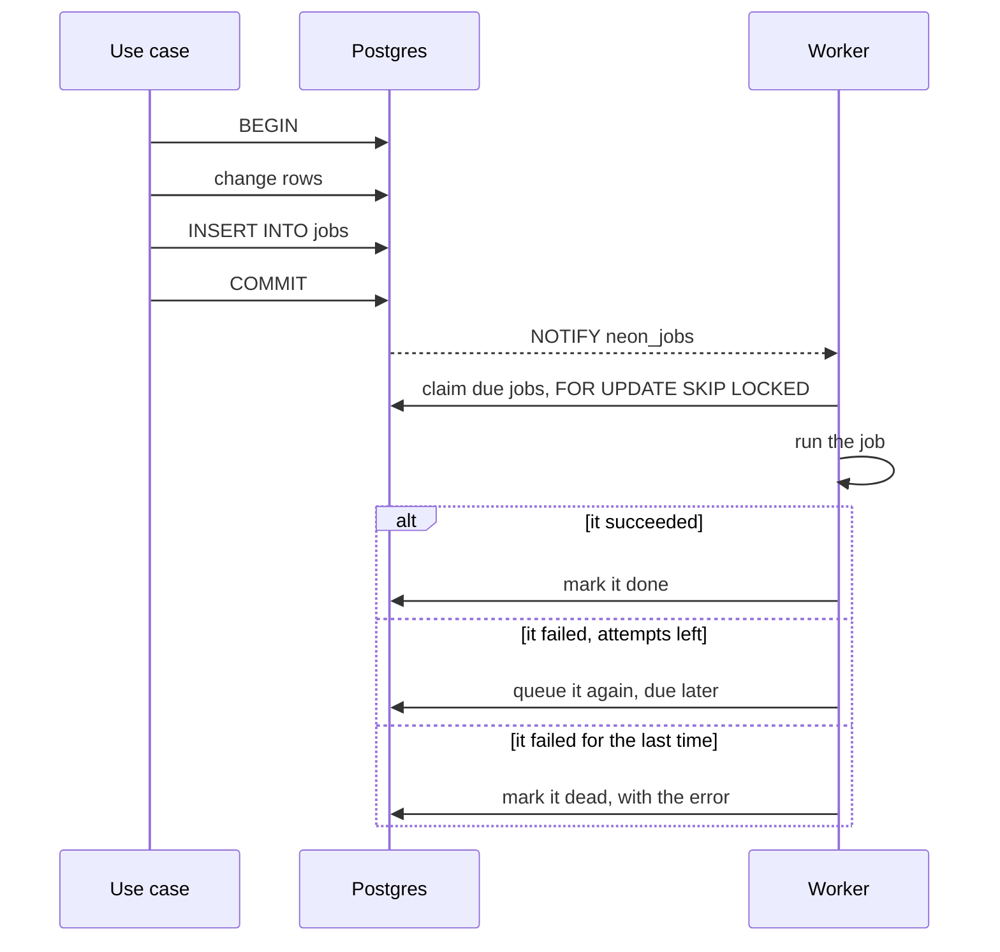

Everything Neon Teamspace keeps lasting is in one Postgres 18 database: settings, the job
queue, accounts, sessions, invites, workspaces with their members, teamspaces, invitations
and invite links, pages with their shares and favorites, and, as it arrives, their content,
and databases with their properties, views and rows' values.
There is no
cache server and no message broker beside it. Attachments' bytes are the one exception: they
go to local disk or an S3-compatible store, as files are better kept outside the database,
while Postgres keeps what each file is.

## Postgres

The server keeps one connection pool, sized by `database.max_connections`, and shares it
between the HTTP handlers and the job queue's workers. The job worker holds one more
connection of its own, outside the pool, to listen for new jobs. The pool's connections, idle
and in use, are gauges on `/metrics`, and `/readyz` pings the database through the pool; see
[Observability](/docs/architecture/observability/#gauges). Work that must happen together runs in
one transaction. A use case in `neon-app` opens it and passes it, as `&mut Transaction`, to
each repository it calls in `neon-store`, so what commits together is decided in one place,
the use case, and never inside a repository.

## Queries

SQL is written by hand, in the repositories of `neon-store`, with sqlx's `query!` and
`query_as!` macros. As the crate compiles, each macro sends its query to Postgres to be
prepared, and the compiler gets back the types of its parameters and columns. A query that
names a column that is gone, compares a `uuid` with `text`, or reads a nullable column into a
type that cannot be null does not compile.

The answers are kept in `.sqlx/`, one file per query, committed with the code. Builds use
them instead of a database when `SQLX_OFFLINE=true` is set, or when `DATABASE_URL` is not, so
a fresh checkout builds with no Postgres running. After a query changes, with the database
running and migrated:

```sh
cargo sqlx prepare --workspace
```

rewrites the cache, and `cargo sqlx prepare --workspace --check` fails when the committed
cache no longer matches the queries.

There is no ORM and no query builder. A query reads as the SQL that runs, and features such
as `FOR UPDATE SKIP LOCKED`, `jsonb` operators and full-text search are used directly.

## Migrations

The schema is built by migrations, plain SQL files in `migrations/`, one per change, named
by the time they were made. They are embedded in the `neon` binary, so a deployment carries
its own schema.

The server applies the ones the database lacks as it starts, unless `database.auto_migrate`
is `false`; then `neon migrate` applies them and exits, for deployments that migrate as a
separate step. Each runs in its own transaction, and Postgres records which have run.

Migrations only go forward. Nobody edits a released one; a change is a new migration.
There are no down migrations, as no SQL can bring back the data a schema change dropped.
To go back, restore the backup taken before the upgrade.

## Databases

A database and its rows are rows of `pages`, of kinds `database` and `row`; their own data is
beside them. `databases` holds each database's next row number, which only grows, so a number
is never given twice. `database_properties` and `database_views` hold the properties and
views, each with its settings as the domain rules write them, in a `jsonb` column, and its
position among the others, ordered as pages are. `database_rows` holds each row's number and
its `cells`: a `jsonb` object of values by property id.

A change to a row's values sets and removes single keys of `cells` in one statement,
`(cells || $set) - $removed`, so two changes to different properties never undo one another,
and of two changes to one property the last to commit wins. Queries read every row of a
database at once, by its `database_id`, and the domain rules filter, sort and group them,
which is why a database holds at most 10,000; a unique index on the database and the number
finds a row by its unique id. Unique indexes also keep one title, at most one unique id, and
names apart ignoring case.

## IDs

Rows are identified by UUIDv7, generated in the server. The first 48 bits of a UUIDv7 are a
timestamp in milliseconds, so new IDs sort after older ones. They land at the end of an index
instead of at random places in it, a list ordered by ID is ordered by creation, and the
server knows a row's ID before inserting it, with no round trip. Most of the remaining bits
are random, so IDs made in the same millisecond still differ.

IDs are not secrets. Anything that grants access, such as a session, an invite or an API
token, is a separate random value of its own, kept only as its hash.

## The job queue

Work that happens after a request, or on a schedule, runs as a **job**. Mail is one, of kind
`mail.send`, and so is each delivery of an outgoing webhook, of kind `webhooks.deliver`, and
the mail of each notification, of kind `notifications.mail`, due once it has waited
`notifications.mail_delay`, which writes its mail as a `mail.send` job if it is still unread.
Imports and exports are
not jobs: the request that asks for one waits for it, within
[their limits](/docs/guides/import-export/#limits), and gets the file or the pages made in its
answer. The hourly cleanup of expired sessions, links and invites, and of webhooks' rotated
secrets once they stop holding, is not a job but a
task of the server process: it needs no retries, since the next run catches up. So are the
notification digests, every five minutes: each run takes the people whose digest is due
with `FOR UPDATE SKIP LOCKED`, so two runs never write the same one. Nothing else goes through it: edits apply live, and search text is
updated with the page it comes from; see [Search](#search).

The queue is a Postgres table, `jobs`. Each row has a kind, a JSON payload, a status
(`queued`, `running`, `done` or `dead`), the time it is next due, how many attempts it has
had and may have, and the last error.



### Enqueued with the change

A job is inserted in the same transaction as the change that caused it. If the change rolls
back, so does the job, and nothing is sent for a change that never happened; if it commits,
the job is there. There is no window between writing the change and queueing its job in
which a crash could lose one or the other, which a queue outside the database would have.

### Claimed with SKIP LOCKED

Workers claim due jobs with `SELECT … FOR UPDATE SKIP LOCKED`: each locks the rows it
takes, and passes over those another worker has locked rather than waiting for them. Several
workers then share the queue without taking the same job twice and without blocking each
other.

A job whose worker stopped, because the process crashed or was killed, is claimed again once
its lock is old enough. A job can therefore run more than once, and every job is written so
that running it twice does the same as running it once.

The server's worker runs eight jobs at once. A kind that may have many jobs takes only a
share of those slots: webhook deliveries run at most four at once, so mail and the other
kinds always find a slot free, however many deliveries wait for slow receivers. Within its
share, and among the other kinds, the job due first runs first.

### Retries with backoff

A job that fails is queued again, due later, and the delay grows with each attempt, so a
service that is down is not called in a tight loop. A job that fails its last attempt, or
fails in a way a retry cannot fix, such as a payload it cannot read, is marked `dead` and
kept with its error, to be looked at. Dead jobs and done ones are deleted seven days after
they finished, except the kinds whose payload must not outlive the run. Mail is one: its
payload is sealed, as it carries one-time links, and its job is deleted as soon as it is
done or dead.

### Woken by LISTEN and NOTIFY

Inserting a job notifies the channel `neon_jobs`. Postgres delivers a notification when its
transaction commits, and never when it rolls back, so workers wake as soon as a job can be
seen, without polling every moment. They also look for due jobs at a steady interval, which
picks up jobs delayed by a retry and any notification missed while a connection was down.

### Traced and measured across the queue

Queueing a job stores the W3C `traceparent` of the current span in its row, unless the caller
passes one. A job queued while handling a request keeps the request's trace that way. The
worker runs each job in a span named `job <kind>` whose parent comes from the row, so the run
continues the request's trace, however much later it runs. A job queued outside any span has
no `traceparent`, and its run starts a trace of its own.

Each run also counts in the RED metrics of the `jobs` subsystem, with the job's kind as the
operation. A failed run that will be retried is an expected error: its span keeps an unset
status and it counts as `ok`. A run that leaves the job dead, panics or is cancelled is an
error. The queue's depth by status is a gauge. Both are described in
[Observability](/docs/architecture/observability/#red-metrics).

## Settings

Runtime settings that admins save are rows of the `settings` table, one per key. Each change
is also a row of `settings_audit`, with the value before and after, who made it and when.
Secret values are recorded as redacted. How the database fits with the environment and the
file is in [Configuration](/docs/self-hosting/configuration/).

## Pages

Each page is a row of `pages`, in one workspace and in exactly one space: `teamspace_id` for
a teamspace's page, `owner_id` for a private one. Its `parent_id` points to the page it is
under. Composite foreign keys keep a parent in the same workspace and the same space, and
deleting a page, a teamspace or a workspace deletes the pages in or under it, with
everything that belongs to them.

Siblings sort by `position`, a key of the characters `0-9A-Za-z` that the column compares
byte by byte, with the `C` collation, whatever the database's locale. The server works out a
new key from its neighbours' keys alone; [Pages](/docs/guides/pages/#order) describes how.

A change to a workspace's tree, making, moving, trashing, restoring or deleting a page,
first takes a transaction-scoped advisory lock on that workspace's tree. Such changes run
one at a time, so a new key comes from siblings that nothing else is moving, and two moves
at once cannot close a cycle between them. Moving a page to another space rewrites the
space of every page under it in the same statement, and the foreign keys hold once the
statement ends. The trees themselves are read with recursive queries, which also carry the
shares a person has down each branch.

Trashing a page sets `trashed_at` on it and on every page under it that is not in the trash
already, with `trashed_with` naming the page trashed. Restoring brings back the pages with
the same `trashed_with` down from the restored one, so a subpage trashed on its own earlier
stays where it is. `page_shares` holds each share, `view`, `comment` or `edit`, `favorites`
each account's favorites with keys of their own; both go when their page goes, and when the
person leaves the workspace.

## Comments and the inbox

[Comments](/docs/guides/comments-and-mentions/) are rows, not part of the page's document:

| Table | What it holds |
|---|---|
| `comment_threads` | Each thread, on its page: for an inline one, the two Yjs relative positions of its range, at most 256 bytes each, and the text it was made on; who resolved it and when. |
| `comments` | Each comment of a thread, in order, its markdown, its author, and when it was last changed. |
| `page_follows` | Who follows a page's comments, or chose not to, `follows` true or false, so a choice made by hand holds. |
| `page_mentions` | Whom a page's text mentions now, each with the first block they are in, as its last snapshot has it. |
| `notifications` | Each person's [inbox](/docs/guides/inbox/): its kind, who did it, what it is about, and when it was read, archived and mailed. A unique index keeps one per comment for each person. |
| `notification_preferences` | How each person who chose wants mail of their inbox, and when their last digest went. |

Each goes with its page, its thread or comment, or its person. A notification is never
deleted for a page its person can no longer see: whether they may is asked again whenever it
is listed or counted.

## Content

Content is stored according to how it is edited. Pages' documents, their history, databases'
properties, search and attachments are kept as below.

- **Pages** are Yjs documents. Postgres keeps each page's log of updates, `page_updates`,
  numbered in order with their authors, and the latest snapshot of the whole document,
  `page_snapshots`, which takes in the updates before it: they are deleted in the same
  transaction. An imported page starts with a snapshot of its content and an empty log.
  What a document holds, and how the server reads it, is in
  [Page documents](/docs/architecture/documents/); how the live documents log and compact,
  in [Real-time sync](/docs/architecture/realtime/#saving).
- **Page history** is a version of the document's blocks each time a snapshot changes what
  the page shows; see [History](#history).
- **Database properties**, such as a row's status or assignee, are plain columns and rows,
  so views filter, sort and group them in SQL.
- **Search** is Postgres full-text search with the `simple` configuration, which does not
  stem words and so works the same for any language, together with `pg_trgm` for titles
  typed loosely; see [Search](#search).
- **Attachments** are rows of `files`, each with its page, workspace, uploader, kind, name,
  type, size, SHA-256 and an image's width and height, and its bytes in the
  [blob store](/docs/self-hosting/storage/) under `storage_key`, made for it alone. A file
  belongs to its page and goes with it, by the foreign key; a workspace's storage is the sum
  of its files' sizes, which every upload checks against its limit with the workspace's row
  locked, so uploads at once cannot together pass it. `pages.cover_file_id` names a page's
  cover image, one of its own files. Each snapshot of a page records the files its
  document shows in `page_file_refs`, by the ids in their paths, in the same transaction, and
  each version the history keeps those it shows in `version_file_refs`, which go with the
  version, for the cleanup to keep them. A file's row going, however it goes, leaves its key in
  `blob_deletions` through a trigger, and so does an upload as it starts, due half an hour
  later and taken out once its row is in; the hourly cleanup deletes the blobs due, then
  their rows. [Attachments](/docs/guides/attachments/#when-files-are-deleted) has the rules.

The reasons are in [Key decisions](/docs/architecture/decisions/#content).

## History

`page_versions` holds a page's versions: the document's blocks as BlockNote's JSON, in
`content`, when the latest change they hold was made, the authors of the updates the snapshot
took in since the version before, and how many blocks those added, changed and removed. A
version a restore made names the version restored, while that is kept, and its time, which
stays once it is thinned out. Versions go with their page.

A version is written in the transaction that saves the snapshot it comes from, after the
page's text: the transaction reads the latest version's blocks, compares them with the
snapshot's, and writes nothing when they are the same. So a snapshot and its version commit
together, or neither does. A page made with content writes its first version in the
transaction that makes it. The index on the page, the time and the id lists a page's
history latest first, and lets the hourly cleanup walk the pages a part at a time to thin
them, as [Page history](/docs/guides/history/#how-long-versions-are-kept) describes.

## Search

Everything search reads is in `pages`, kept up to date by the write it comes from, in the
same transaction. Nothing goes through the job queue, so search never lags behind a queue,
and a write that rolls back leaves search as it was.

| Column | Holds | Written |
|---|---|---|
| `title` | The page's title. | As the title is saved. |
| `search_text` | The plain text of the document's blocks. | With each snapshot of the document. |
| `property_text` | A row's text and URL values, one a line, in the properties' order. | By triggers on `database_rows`, when a row is added or its cells change, and on `database_properties`, when a property's type changes. |
| `comment_text` | The words of the page's comments, the newest first, one a line, at most 100,000 characters: each comment's `search_text`, its text without styles or link targets, which the server writes with the comment. | By statement triggers on `comments`, when comments are added, changed or deleted, and on `comment_threads`, when threads are deleted with their comments. Each reads only the newest comments whose words fit, their sizes known without reading them. |
| `search_vector` | A `tsvector` of the four: the title weighted `A`, the values `B`, the text `C`, the comments `D`, at most the first 100,000 characters of each of the last three. The values are read again split at every character but letters and digits, since the parser keeps a URL as one token. | Generated by Postgres from the four, in the statement that writes any of them. |

Two GIN indexes find matches: `pages_search` on `search_vector`, and `pages_title_trigrams`
on the title's trigrams, for the loose match, `<%`, with a word similarity of at least 0.5.
`pg_trgm` is a trusted extension, which the migration creates as the database's owner.

The query filters by access in the database, so whoever sees a few pages of a large
workspace finds them without the database reading every match. The search service first
asks the [rules](/docs/reference/permissions/#pages), for the caller and for an agent's owner,
which teamspaces show their pages, whether their own private pages do, and whether shares
do; the domain's tests prove that these answers, combined, are what the rules answer for
every page. The query is then a union of one branch per way of seeing a page: the pages of
those teamspaces, through the index on the teamspace; the private pages, through the index
on their owner; and the pages under the caller's shares, walked down from the shares. Each
branch applies the match and the filters, and for an agent its owner's own answers. Each
search is planned for its values, with `plan_cache_mode` set to `force_custom_plan` in its
transaction, as one plan for every caller would not tell a guest with three shares from an
owner of every teamspace. A test seeds a workspace of 20,000 matching pages and checks the
plan, through `EXPLAIN ANALYZE`, of a guest's search and of an agent's: each reads a few
dozen rows of `pages`, and never scans the table.

Every page found is asked of the rules again before it is answered, as any page read is;
should the query and the rules ever differ, the rules win and the server logs the page's id.
A test searches as every kind of caller and fails on any such log line, so a difference
shows there rather than as short pages of results.
Ranking is `ts_rank` of the vector, plus the title's word similarity to the query, plus one
for a title that is the query's words, however short. Snippets are `ts_headline`, which
costs more than in proportion to the text it reads, so it reads 5,000 characters of the
values and the text, from 1,000 before the first place one of the query's words is, and
only for the results answered, not the one read past them to tell whether more follow.

A search holds a connection of the pool while it runs, so what it may take is bounded: each
statement of its transaction runs 5 seconds at most, through `statement_timeout`, after
which it answers `503 timeout`; half the pool's connections at most run searches at once,
and a search waits 2 seconds for its turn before it answers `503 busy`; and each user's
searches are rate limited, 60 and then 2 a second.

A server killed before it saved a snapshot leaves updates in `page_updates` that the stored
text lacks, and a page that never had a snapshot has no text at all. `neon search reindex`
reads the document of every such page, its snapshot and the updates after it, and stores
its text when it differs, with the page's row locked, so a snapshot saved at the same
moment waits and writes its own after.

## Backups

A backup is a `pg_dump` of the database and a copy of the attachments' directory or bucket,
taken after it, as [File storage](/docs/self-hosting/storage/#backups) describes. The server migrates the schema forward as a new version starts, and
migrations cannot be undone, so back up before upgrading.
