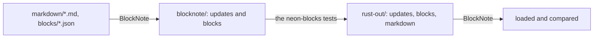

A page's content is one Yjs document. The browser edits it with
[BlockNote](https://www.blocknotejs.org/), which binds its ProseMirror document to the Yjs
document through y-prosemirror. The server holds the same document with yrs, the Rust port of
Yjs. The `neon-blocks` crate reads the blocks out of that document into a typed model, writes
a model back into it in the shape the editor writes, and converts the model to and from
markdown. The live documents read a page's text through it for search as they save,
[import and export](/docs/guides/import-export/) convert pages through it, and agents read
and edit pages through it, over [MCP](/docs/guides/agents-over-mcp/#editing-a-page) and the
API, its edits made in the live document.
Like `neon-domain`, it does no I/O and has no async code.

## The fragment

A Yjs document can hold several shared types side by side, each under a name. The page's
blocks are the `XmlFragment` named **`document-store`**. The web app's editor passes that
fragment to BlockNote's collaboration options, and the crate exports the name as
`neon_blocks::FRAGMENT`.
Nothing else in the document belongs to the editor, so other data, such as comments, can sit
beside it under names of its own.

## The structure

y-prosemirror mirrors each ProseMirror node as an `XmlElement` named after the node's type,
with the node's attributes as the element's. A run of text becomes an `XmlText`, whose
formatting attributes are the text's marks. BlockNote's schema nests blocks in containers:

```text
XmlFragment "document-store"
  blockGroup
    blockContainer id="block-1"
      paragraph backgroundColor="default" textColor="default" textAlignment="left"
        XmlText "Some bold text"         bold: {} over "bold"
        hardBreak
        XmlText "after a line break"
      blockGroup                         the block's children, when it has any
        blockContainer id="block-2"
          bulletListItem ...
    blockContainer id="block-3"
      table textColor="default"
        tableRow
          tableHeader colspan=1 rowspan=1 colwidth=[120] ...
            tableParagraph
              XmlText "A header cell"
```

- The fragment holds one `blockGroup`. An empty fragment is a page nobody has written to yet,
  which the editor opens with one empty paragraph.
- A `blockContainer` carries the block's `id` and holds the block's content element, then a
  `blockGroup` of its children if it has any.
- The content element's name is the block's type, and its attributes are the block's props.
  y-prosemirror writes every prop that is not `null`, defaults included, so a plain paragraph
  still carries `backgroundColor="default"`. An optional prop with no value, such as an
  image's `previewWidth` or a database's `viewId`, is written as `undefined`.
- Text with marks is one `XmlText` per run of text between hard breaks. Each mark is a
  formatting attribute: `bold`, `italic`, `underline`, `strike` and `code` map to `{}`,
  `textColor` and `backgroundColor` to `{"stringValue": "red"}`, and `link` to
  `{"href": "https://..."}`.
- A line break inside a block is a `hardBreak` element between two texts.
- A table is `table > tableRow > tableHeader | tableCell > tableParagraph`. Header cells are
  `tableHeader` elements; each cell carries its spans, colours, alignment and `colwidth`, the
  widths of the columns it spans.

y-prosemirror deletes an element whose type the schema lacks, and a text whose marks it does
not know, the moment an editor opens the page. The crate's writer only makes what the schema
has, and its reader returns an error for an element it does not know rather than skipping it.

### Block types

The editor's schema is BlockNote's default blocks, as of the version
`tools/blocknote-fixtures` pins, and one block of the app's own. These are the defaults:

| Type | Props | Content |
|---|---|---|
| `paragraph` | `backgroundColor`, `textColor`, `textAlignment` | text |
| `heading` | the same, `level` 1 to 6, `isToggleable` | text |
| `bulletListItem`, `toggleListItem` | `backgroundColor`, `textColor`, `textAlignment` | text |
| `numberedListItem` | the same, `start` | text |
| `checkListItem` | the same, `checked` | text |
| `quote` | `backgroundColor`, `textColor` | text |
| `codeBlock` | `language`, `text` when none | unstyled text |
| `divider` | none | none |
| `table` | `textColor` | rows of cells |
| `image`, `video` | `textAlignment`, `backgroundColor`, `name`, `url`, `caption`, `showPreview`, `previewWidth` | none |
| `audio` | `backgroundColor`, `name`, `url`, `caption`, `showPreview` | none |
| `file` | `backgroundColor`, `name`, `url`, `caption` | none |

Colours are names such as `red` or `blue`, and `default` for none. Alignment is `left`,
`center`, `right` or `justify`.

The app's own block is a database shown in the page:

| Type | Props | Content |
|---|---|---|
| `database` | `databaseId`, empty for a block not given a database yet; `viewId`, the view it shows the database in, `undefined` when it names none | none |

```text
blockContainer id="block-4"
  database databaseId="0193a5b2-0000-7000-8000-0000000000d1" viewId=undefined
```

Its config, the type's name, its props with their defaults and its content, is defined once,
in `web/src/components/editor/custom-blocks.ts`. The web app's editor makes its block from it
and draws it as the database's views, inside the page, as
[the web app](/docs/architecture/web/#databases) describes. The module imports
nothing, so `tools/blocknote-fixtures` imports it too, by its path, and tests the crate against
an editor with the same schema. A page opened in an editor without the block would lose it,
as y-prosemirror deletes what the schema lacks.

## The model

The crate's `Document` is a list of `Block`s, each with an optional id, its type with that
type's props and content, and its children. Its JSON form, through serde, is BlockNote's own
block format:

```json
{
  "id": "block-1",
  "type": "paragraph",
  "props": { "backgroundColor": "default", "textColor": "default", "textAlignment": "left" },
  "content": [
    { "type": "text", "text": "Some ", "styles": {} },
    { "type": "text", "text": "bold", "styles": { "bold": true } },
    { "type": "link", "href": "https://example.com", "content": [{ "type": "text", "text": "a link", "styles": {} }] }
  ],
  "children": []
}
```

Blocks the editor exports deserialize into the model, and the model serializes into blocks
BlockNote takes. Reading follows BlockNote's own conversion, so a document read from Yjs is in
the form BlockNote reads it in: a line break is `\n` at the end of the text before it, runs
with the same styles are merged, and code text carries no other style and no link, as the
editor's code mark excludes them.

The crate's functions:

| Function | What it does |
|---|---|
| `read(txn, fragment)`, `read_doc(doc)` | The document a fragment holds, or why it is not one the editor writes. |
| `read_lenient(txn, fragment)` | What of the fragment reads, as the editor would show it: a block that does not read, such as one of a type the schema does not know, is left out with the blocks under it, and counted. Exports read pages so. |
| `replace(txn, fragment, document, ids)` | Replaces the fragment's blocks, keeping its top-level `blockGroup`. |
| `append(txn, fragment, blocks, ids)` | Adds blocks after the last top-level block. |
| `markdown::to_markdown(document)` | The document as markdown. |
| `markdown::from_markdown(text)` | The blocks of a markdown text, without ids. |
| `Document::plain_text()` | The words of the document, for search. Database blocks are left out, as they hold no words of their own. |
| `diff::diff(before, after)` | Each block of two documents compared: the same, changed, added or removed, in the later one's order, the earlier one's removed blocks where they were. `diff::Summary` counts them, for a page's history. |

Writing gives each block without an id one from the `IdSource` it is passed, parents before
their children. The crate has no source of randomness of its own. The server passes one that
makes random ids, and tests pass a `SequentialIds`, which counts `block-1`, `block-2` and on,
so what they write is the same on every run. Writing a document and reading it back gives the
same document.

## Markdown

Markdown is how content comes in and goes out: imported files, exported pages, and what
agents read and write. The crate writes GitHub-flavoured markdown, and reads it with
pulldown-cmark with GitHub's tables, strikethrough and task lists.

| Block or style | Markdown |
|---|---|
| paragraph | its text; a line break is `\` at the end of a line |
| heading | `#` to `######` |
| bullet list item | `- item` |
| numbered list item | `1. item`, counting up from the list's `start`, at most 999999999, the most CommonMark reads |
| check list item | `- [ ] item`, `- [x] item` |
| toggle list item | `:::toggle Title`, its children, `:::` |
| toggleable heading | `:::toggle ## Title`, its children, `:::` |
| quote | `> text`, holding its children unless the first is a paragraph |
| code block | a fenced block, its language as the info string, which reads back as the info string's first word |
| divider | `---` |
| table | a pipe table whose first row is the header |
| image | `` on a line of its own |
| video, audio, file | `:::video [name](url "caption")`, `:::audio ...`, `:::file ...` |
| database | `:::database <databaseId>`, or `:::database <databaseId> view=<viewId>` when the block names a view |
| bold, italic, strikethrough | `**bold**`, `*italic*`, `~~strike~~` |
| underline | `<u>underline</u>` |
| inline code | `` `code` `` |
| link | `[text](url)` |

Children nest under list items, by indentation, and under toggles. Where CommonMark would not
read a style's delimiters as meant, as in `a**(b)**c`, the writer uses `<strong>`, `<em>` or
`<del>` instead. It checks each line by parsing it. A table column whose cells share a centre
or right alignment gets that alignment, and reading a table gives its cells their column's.

### The extension

Markdown has no syntax for toggles, for video, audio and file blocks, or for databases. A
line of three colons and a name opens one:

```markdown
:::toggle A toggle's title, with **styles**

Its children: any markdown, other toggles too.

:::

:::toggle ## A toggleable heading
:::

:::video [demo.mp4](https://example.com/demo.mp4 "A caption")

:::database 0193a5b2-0000-7000-8000-0000000000d1 view=0193a5b2-0000-7000-8000-0000000000e1
```

- `:::toggle` takes the rest of its line as the title, parsed as markdown. A heading there
  makes a toggleable heading of its level, anything else a toggle list item.
- The toggle's children follow, until a line of colons alone closes it. The end of the list
  item, quote or document the toggle is in also closes it, so a missing `:::` loses nothing.
- `:::video`, `:::audio` and `:::file` take one link: its text is the file's name, its target
  the URL, and its title the caption.
- `:::database` takes the database's id, then `view=` and the view's id. The writer leaves out
  the database's id when it is empty and `view=` when the block names no view. An id that
  holds anything but ASCII letters, digits, `-`, `_`, `.` and `~` is percent-encoded, as in
  `50%25`, so a UUID is written as it is and any id comes back the same. Any other word on the
  line makes it text.
- A line of colons that closes nothing is text, and so is a line that starts with an escaped
  colon, `\:::`. The writer escapes text that would otherwise read as the extension.

A renderer that does not know the extension shows the lines as text, with the links still
links.

### Block ids

Markdown can name blocks too, for those that edit a page by its blocks, such as
[agents over MCP](/docs/guides/agents-over-mcp/#block-ids). Each block's lines then follow a
line `<!-- block <id> -->` at the block's level, the id percent-encoded as a database's is.
Every block with an id gets one, empty paragraphs included. Reading markdown drops those
lines wherever they stand but in code, before it parses the rest. Markdown written with them
reads as the same blocks as without them, and a numbered list named item by item stays one
list. The exception is a line with no lines of the block after it, followed by a blank line,
another such line or the end of what holds it: it reads as the empty paragraph it names, so
empty paragraphs come back too. A test writes every fixture with its ids and checks just
that.

### What markdown loses

Markdown cannot hold everything a page can. Writing drops:

- block ids;
- text and background colours, of blocks and of text;
- text alignment, but for a table column's;
- empty paragraphs;
- the nesting of children under blocks other than list items, toggles and quotes, and under a
  quote whose first child is a paragraph, which are written after their parent at its level;
- a link without text, which the editor cannot hold either;
- the words of a code block's language after its first, as in `c sharp`, since the info
  string's first word is the language;
- tables' column widths, header columns, spans and cell colours, and a table without a header
  row, which comes back with its first row as the header;
- images' and videos' preview widths, and whether a file shows a preview;
- a numbered list item that restarts at 1 right after another numbered list;
- whitespace at the edges of bold, italic and strikethrough text, which moves outside the
  style.

Everything else comes back as it was; a carriage return in text is written `&#13;`, so it
stays one. Reading what was written and writing it again gives the same markdown, so a page
that goes out and comes back changes at most once. Reading markdown, a soft line break is a
space, as CommonMark has it. Raw HTML other than the tags above stays
text, and an image inside a paragraph splits it, since images are blocks.

Blocks read from markdown nest at most 32 levels deep. A quote or list item that would be
deeper is left out, its content read at its parent's level; a toggle, quote or list item at
the 32nd level holds no children, which follow it there instead; and a line that starts with
more than 33 quote or list markers reads the rest as text. An import reads such markdown that
way, while what callers send refuses it: a new page's markdown and the edits of the markdown
API and [MCP](/docs/guides/agents-over-mcp/#editing-a-page) answer `invalid_input`, and an
[incoming webhook](/docs/guides/webhooks/#the-payload) `invalid_payload`.

## Edits in place

The crate also edits a page's Yjs document in place, for the server's tools. Its edits are:

- adding blocks at the end, before the empty paragraph the editor keeps last, or right after
  a block;
- replacing a range of sibling blocks;
- replacing text within one line of a block's text, table cells and code included, the
  replacement taking the styles of the first character it replaces. It replaces at most
  10000 times, rewrites each text node in one pass, and refuses replacements that would add
  more text than the room it is given;
- replacing the whole body. A block that writes the same markdown as one of the new ones, in
  order, stays, with its id, colours and whatever is typed in it. Blocks compare as markdown
  shows them: the children of a paragraph and the other blocks markdown cannot nest under
  compare one by one after it, and stay while it does. So the body read with its ids and
  sent back unchanged changes nothing;
- restoring a version of the page, which makes the page hold exactly the version's blocks,
  ids, props and nesting included. Each level is matched with the version's by the blocks'
  ids, a longest common sequence of them, and blocks without ids by what they hold. A block
  both have stays where the version has it, its content element written anew only when its
  type, props or content differ, and its children are restored a level down; the page's
  other blocks go, and the version's are written in with their ids.

Comparing two versions, `diff`, matches blocks the same way, so a block whose text changed
shows as changed, and one moved under another as removed and added.

Each edit changes only what it names, in one transaction, so it merges with what others type
meanwhile. It checks what it needs before it changes anything. Offsets in text count as the
document does, in bytes or UTF-16 units. A group of children left empty goes, since the
editor's schema has no empty ones, and a page left without blocks gets an empty paragraph.

## Tested against BlockNote

`tools/blocknote-fixtures` is a small Bun project that runs BlockNote's server-side editor,
`@blocknote/server-util`, with the editor's schema: the default blocks, and the app's own made
from the configs in `custom-blocks.ts`. It pins `@blocknote/core`, `@blocknote/react` and
`@blocknote/server-util` to 0.57.0, with `yjs` 13.6.33 and `y-prosemirror` 1.3.7, and the web
app's editor takes the same versions, with `@blocknote/shadcn` at 0.57.0 too. The fixtures live in
`crates/blocks/tests/fixtures`:



- The corpus is markdown that BlockNote's parser and the crate's should agree on, and blocks in
  BlockNote's JSON for what markdown cannot carry, among them the app's database block, which
  BlockNote's parser never makes. Together they cover every block type of the editor's schema
  and every style.
- BlockNote turns each sample into a Yjs update, `blocknote/<name>.yjs`, and the blocks it
  reads back from it, `blocknote/<name>.json`. Block ids count up in document order and the
  Yjs client id is fixed, so the files are the same on every run.
- The crate's tests read each update with yrs and expect BlockNote's blocks, parse each
  markdown sample and expect what BlockNote's parser made of it, and write each document and
  read it back.
- The tests also write `rust-out/`: the update the crate writes for each document, its blocks
  as JSON, and its markdown. The fixtures tool loads each update in BlockNote, checks the
  ProseMirror document against the schema, expects the blocks in the JSON, and compares the
  update's structure with the one BlockNote writes for the same blocks.

`make blocks-check` runs both directions and fails when any fixture is stale, and `make
check` includes it. After a change to the corpus, the crate, the app's block configs or the
BlockNote version, `make blocks-fixtures` rewrites the fixtures, BlockNote's first and then the
crate's from them, and CI runs the block fixtures job on a change to any of them.
Dependabot bumps the tool's packages in the same pull request as the other JS projects'; CI's
block fixtures job fails on it until the fixtures are rewritten on that branch.
