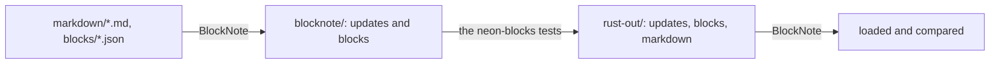

A page's content is one Yjs document. The browser edits it with
[BlockNote](https://www.blocknotejs.org/), which binds its ProseMirror document to the Yjs
document through y-prosemirror. The server holds the same document with yrs, the Rust port of
Yjs. The `neon-blocks` crate reads the blocks out of that document into a typed model, writes
a model back into it in the shape the editor writes, and converts the model to and from
markdown. Export, import, search and agents' edits, all **planned**, are to go through it.
Like `neon-domain`, it does no I/O and has no async code.

## The fragment

A Yjs document can hold several shared types side by side, each under a name. The page's
blocks are the `XmlFragment` named **`document-store`**. The web app's editor, **planned**,
passes that fragment to BlockNote's collaboration options, and the crate exports the name as
`neon_blocks::FRAGMENT`.
Nothing else in the document belongs to the editor, so other data, such as comments, can sit
beside it under names of its own.

## The structure

y-prosemirror mirrors each ProseMirror node as an `XmlElement` named after the node's type,
with the node's attributes as the element's. A run of text becomes an `XmlText`, whose
formatting attributes are the text's marks. BlockNote's schema nests blocks in containers:

```text
XmlFragment "document-store"
  blockGroup
    blockContainer id="block-1"
      paragraph backgroundColor="default" textColor="default" textAlignment="left"
        XmlText "Some bold text"         bold: {} over "bold"
        hardBreak
        XmlText "after a line break"
      blockGroup                         the block's children, when it has any
        blockContainer id="block-2"
          bulletListItem ...
    blockContainer id="block-3"
      table textColor="default"
        tableRow
          tableHeader colspan=1 rowspan=1 colwidth=[120] ...
            tableParagraph
              XmlText "A header cell"
```

- The fragment holds one `blockGroup`. An empty fragment is a page nobody has written to yet,
  which the editor opens with one empty paragraph.
- A `blockContainer` carries the block's `id` and holds the block's content element, then a
  `blockGroup` of its children if it has any.
- The content element's name is the block's type, and its attributes are the block's props.
  y-prosemirror writes every prop that is not `null`, defaults included, so a plain paragraph
  still carries `backgroundColor="default"`. An optional number with no value, such as an
  image's `previewWidth`, is written as `undefined`.
- Text with marks is one `XmlText` per run of text between hard breaks. Each mark is a
  formatting attribute: `bold`, `italic`, `underline`, `strike` and `code` map to `{}`,
  `textColor` and `backgroundColor` to `{"stringValue": "red"}`, and `link` to
  `{"href": "https://..."}`.
- A line break inside a block is a `hardBreak` element between two texts.
- A table is `table > tableRow > tableHeader | tableCell > tableParagraph`. Header cells are
  `tableHeader` elements; each cell carries its spans, colours, alignment and `colwidth`, the
  widths of the columns it spans.

y-prosemirror deletes an element whose type the schema lacks, and a text whose marks it does
not know, the moment an editor opens the page. The crate's writer only makes what the schema
has, and its reader returns an error for an element it does not know rather than skipping it.

### Block types

These are BlockNote's default blocks, as of the version `tools/blocknote-fixtures` pins.

| Type | Props | Content |
|---|---|---|
| `paragraph` | `backgroundColor`, `textColor`, `textAlignment` | text |
| `heading` | the same, `level` 1 to 6, `isToggleable` | text |
| `bulletListItem`, `toggleListItem` | `backgroundColor`, `textColor`, `textAlignment` | text |
| `numberedListItem` | the same, `start` | text |
| `checkListItem` | the same, `checked` | text |
| `quote` | `backgroundColor`, `textColor` | text |
| `codeBlock` | `language`, `text` when none | unstyled text |
| `divider` | none | none |
| `table` | `textColor` | rows of cells |
| `image`, `video` | `textAlignment`, `backgroundColor`, `name`, `url`, `caption`, `showPreview`, `previewWidth` | none |
| `audio` | `backgroundColor`, `name`, `url`, `caption`, `showPreview` | none |
| `file` | `backgroundColor`, `name`, `url`, `caption` | none |

Colours are names such as `red` or `blue`, and `default` for none. Alignment is `left`,
`center`, `right` or `justify`.

## The model

The crate's `Document` is a list of `Block`s, each with an optional id, its type with that
type's props and content, and its children. Its JSON form, through serde, is BlockNote's own
block format:

```json
{
  "id": "block-1",
  "type": "paragraph",
  "props": { "backgroundColor": "default", "textColor": "default", "textAlignment": "left" },
  "content": [
    { "type": "text", "text": "Some ", "styles": {} },
    { "type": "text", "text": "bold", "styles": { "bold": true } },
    { "type": "link", "href": "https://example.com", "content": [{ "type": "text", "text": "a link", "styles": {} }] }
  ],
  "children": []
}
```

Blocks the editor exports deserialize into the model, and the model serializes into blocks
BlockNote takes. Reading follows BlockNote's own conversion, so a document read from Yjs is in
the form BlockNote reads it in: a line break is `\n` at the end of the text before it, runs
with the same styles are merged, and code text carries no other style and no link, as the
editor's code mark excludes them.

The crate's functions:

| Function | What it does |
|---|---|
| `read(txn, fragment)`, `read_doc(doc)` | The document a fragment holds. |
| `replace(txn, fragment, document, ids)` | Replaces the fragment's blocks, keeping its top-level `blockGroup`. |
| `append(txn, fragment, blocks, ids)` | Adds blocks after the last top-level block. |
| `markdown::to_markdown(document)` | The document as markdown. |
| `markdown::from_markdown(text)` | The blocks of a markdown text, without ids. |
| `Document::plain_text()` | The words of the document, for search. |

Writing gives each block without an id one from the `IdSource` it is passed, parents before
their children. The crate has no source of randomness of its own. The server passes one that
makes random ids, and tests pass a `SequentialIds`, which counts `block-1`, `block-2` and on,
so what they write is the same on every run. Writing a document and reading it back gives the
same document.

## Markdown

Markdown is how content comes in and goes out: imported files, exported pages, and what
agents read and write. The crate writes GitHub-flavoured markdown, and reads it with
pulldown-cmark with GitHub's tables, strikethrough and task lists.

| Block or style | Markdown |
|---|---|
| paragraph | its text; a line break is `\` at the end of a line |
| heading | `#` to `######` |
| bullet list item | `- item` |
| numbered list item | `1. item`, counting up from the list's `start` |
| check list item | `- [ ] item`, `- [x] item` |
| toggle list item | `:::toggle Title`, its children, `:::` |
| toggleable heading | `:::toggle ## Title`, its children, `:::` |
| quote | `> text` |
| code block | a fenced block, its language as the info string |
| divider | `---` |
| table | a pipe table whose first row is the header |
| image | `` on a line of its own |
| video, audio, file | `:::video [name](url "caption")`, `:::audio ...`, `:::file ...` |
| bold, italic, strikethrough | `**bold**`, `*italic*`, `~~strike~~` |
| underline | `<u>underline</u>` |
| inline code | `` `code` `` |
| link | `[text](url)` |

Children nest under list items, by indentation, and under toggles. Where CommonMark would not
read a style's delimiters as meant, as in `a**(b)**c`, the writer uses `<strong>`, `<em>` or
`<del>` instead. It checks each line by parsing it. A table column whose cells share a centre
or right alignment gets that alignment, and reading a table gives its cells their column's.

### The extension

Markdown has no syntax for toggles or for video, audio and file blocks. A line of three
colons and a name opens one:

```markdown
:::toggle A toggle's title, with **styles**

Its children: any markdown, other toggles too.

:::

:::toggle ## A toggleable heading
:::

:::video [demo.mp4](https://example.com/demo.mp4 "A caption")
```

- `:::toggle` takes the rest of its line as the title, parsed as markdown. A heading there
  makes a toggleable heading of its level, anything else a toggle list item.
- The toggle's children follow, until a line of colons alone closes it. The end of the list
  item, quote or document the toggle is in also closes it, so a missing `:::` loses nothing.
- `:::video`, `:::audio` and `:::file` take one link: its text is the file's name, its target
  the URL, and its title the caption.
- A line of colons that closes nothing is text, and so is a line that starts with an escaped
  colon, `\:::`. The writer escapes text that would otherwise read as the extension.

A renderer that does not know the extension shows the lines as text, with the links still
links.

### What markdown loses

Markdown cannot hold everything a page can. Writing drops:

- block ids;
- text and background colours, of blocks and of text;
- text alignment, but for a table column's;
- empty paragraphs;
- the nesting of children under blocks other than list items and toggles, which are written
  after their parent at its level;
- tables' column widths, header columns, spans and cell colours, and a table without a header
  row, which comes back with its first row as the header;
- images' and videos' preview widths, and whether a file shows a preview;
- a numbered list item that restarts at 1 right after another numbered list;
- whitespace at the edges of bold, italic and strikethrough text, which moves outside the
  style.

Everything else comes back as it was. Reading what was written and writing it again gives the
same markdown, so a page that goes out and comes back changes at most once. Reading markdown,
a soft line break is a space, as CommonMark has it. Raw HTML other than the tags above stays
text, and an image inside a paragraph splits it, since images are blocks.

## Tested against BlockNote

`tools/blocknote-fixtures` is a small Bun project that runs BlockNote's server-side editor,
`@blocknote/server-util`. It pins `@blocknote/core`, `@blocknote/react` and
`@blocknote/server-util` to 0.57.0, with `yjs` 13.6.33 and `y-prosemirror` 1.3.7, and the web
app's editor, **planned**, takes the same versions. The fixtures live in
`crates/blocks/tests/fixtures`:



- The corpus is markdown that BlockNote's parser and the crate's should agree on, and blocks in
  BlockNote's JSON for what markdown cannot carry. Together they cover every default block
  type and every style.
- BlockNote turns each sample into a Yjs update, `blocknote/<name>.yjs`, and the blocks it
  reads back from it, `blocknote/<name>.json`. Block ids count up in document order and the
  Yjs client id is fixed, so the files are the same on every run.
- The crate's tests read each update with yrs and expect BlockNote's blocks, parse each
  markdown sample and expect what BlockNote's parser made of it, and write each document and
  read it back.
- The tests also write `rust-out/`: the update the crate writes for each document, its blocks
  as JSON, and its markdown. The fixtures tool loads each update in BlockNote, checks the
  ProseMirror document against the schema, expects the blocks in the JSON, and compares the
  update's structure with the one BlockNote writes for the same blocks.

`make blocks-check` runs both directions and fails when any fixture is stale, and `make
check` includes it. After a change to the corpus, the crate or the BlockNote version, `make
blocks-fixtures` rewrites the fixtures, BlockNote's first and then the crate's from them.
Dependabot bumps the tool's packages in the same pull request as the other JS projects'; CI's
block fixtures job fails on it until the fixtures are rewritten on that branch.
