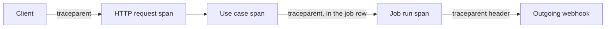

The server reports through one crate, `neon-observability`, which every crate but
`neon-domain` uses. It is built on the Rust ecosystem's own facades: `tracing` for logs and
spans, `metrics` for counters, gauges and histograms, and OpenTelemetry for exporting traces.
Code reports through the facades, and the crate decides once, at start, where it all goes.
Its settings are under `observability` in [the configuration](/docs/self-hosting/configuration/),
in five sections: `logging`, `metrics`, `tracing`, `profiling` and `admin`.

## Logs

Logs go to standard output, one JSON object per line, or as indented text for reading in a
terminal during development. The level is a filter directive, such as `info` or
`info,sqlx=warn`, which sets a level for the server and quieter ones for chatty libraries.

Every line written inside a span carries the span's `trace_id` and `span_id`. A log line found
by searching leads to its trace, and a slow trace leads to the lines it logged.

Logs hold no secrets: passwords, tokens and the values of secret settings are never logged.

## Metrics

Metrics are kept in a Prometheus registry and served at `/metrics` on the
[admin listener](#the-admin-listener). Every name starts with `neon_`.

### RED metrics

Each subsystem times its operations the same way, with three metrics for **r**ate,
**e**rrors and **d**uration:

| Metric | Type | Labels | What it counts |
|---|---|---|---|
| `neon_<subsystem>_operations_total` | counter | `operation`, `status` | Operations finished. |
| `neon_<subsystem>_operation_duration_seconds` | histogram | `operation`, `status` | How long they took. |
| `neon_<subsystem>_operations_in_flight` | gauge | `operation` | Operations started and not yet finished. |

`status` is `ok` or `error`. `operation` is a short, fixed name, such as a route template or
a job's kind, never a value from a request, so the number of label sets stays small.

The subsystems are the HTTP API, use cases and jobs, and, as they arrive, MCP tools and
real-time sync. The buckets of each histogram are chosen for what it times, from operations
that take microseconds to jobs that take minutes.

Timing an operation starts a guard. Finishing the guard records the outcome; a guard dropped
without being finished, because the code returned early or panicked, counts as an error. A
path that forgets to report its result therefore shows up as errors, not as nothing.

For example, the share of each operation's requests that failed over five minutes:

```txt
sum by (operation) (rate(neon_http_operations_total{status="error"}[5m]))
  / sum by (operation) (rate(neon_http_operations_total[5m]))
```

### Gauges

Beside the RED metrics, gauges show the state of the parts that hold resources: the
database pool's connections in use and idle, and the job queue's depth, and, **planned**,
open WebSocket connections and the page documents held in memory.

## Traces

Spans are made with `tracing` and exported over OTLP, the OpenTelemetry protocol, through
`tracing-opentelemetry`, to a collector such as Grafana's or Jaeger's. Export is off unless
configured; spans and their IDs exist either way, so logs stay correlated and trace context
still passes on.

Trace context crosses process and time boundaries in the W3C formats, TraceContext
(`traceparent`) and Baggage:



- **Incoming HTTP.** A request that carries `traceparent` continues its caller's trace;
  one that does not starts a new trace.
- **Jobs.** A job row keeps the `traceparent` of the request that queued it, and its run
  continues that trace, minutes or hours later. A mail sent because of a request shows up in
  the request's trace.
- **Outgoing webhooks**, **planned**, carry `traceparent`, so a receiver that traces can join
  the trace too.

### Expected and unexpected errors

Errors come in two kinds, and traces keep them apart:

- **Expected errors** are answers: not found, forbidden, invalid input, a conflict. They are
  part of normal operation. They are recorded as an event on the span, and the span's status
  is left unset.
- **Unexpected errors** are faults: the database is unreachable, a query fails, a bug. They
  set the span's status to error and are logged at the `error` level.

A trace marked as failed then means the server went wrong, not that someone asked for a page
that does not exist.

## Profiles

The server can profile itself, in one of three modes, set in `observability.profiling.mode`:

| Mode | What it does |
|---|---|
| `off` | No profiling. The default. |
| `pull` | Serves profiles at `/debug/pprof/*` on the admin listener, in pprof's format, for a scraper or `pprof` itself to fetch: CPU profiles with `pprof-rs`, and heap profiles from jemalloc on Linux. |
| `push` | Sends profiles from inside the process to a Pyroscope server, with Pyroscope's Rust agent. |

Only one mode runs at a time, because two CPU profilers in one process break each other's
sampling.

## The admin listener

The admin listener is a second HTTP server inside the process, on its own address,
`127.0.0.1:9090` unless `observability.admin.addr` says otherwise
(`NEON_OBSERVABILITY__ADMIN__ADDR`). It is internal: Caddy never exposes it, and it should be
bound to loopback or a private network only, as profiles reveal the server's memory and a CPU
profile holds the process for its duration.

| Path | What it answers |
|---|---|
| `/metrics` | The metrics, in Prometheus's text format. |
| `/livez` | `200` while the process runs. A failing check means it should be restarted. |
| `/readyz` | `200` while the server can take requests, its database reachable; `503` otherwise, and once it begins to shut down. A failing check means traffic should go elsewhere for now. |
| `/debug/pprof/*` | Profiles, in `pull` mode. |

Keeping these apart from the app's port means the public origin has no metrics, probes or
profiles to protect, and a scraper or an orchestrator reaches them without credentials.

## Shutdown

On SIGTERM, or Ctrl-C in a terminal, the server shuts down in order. Each part registers how
it stops as it starts, and the registry stops them in the reverse order, the last started
first:

1. `/readyz` turns to `503`, and the HTTP server stops accepting connections and lets the
   requests in flight finish.
2. The job workers finish the jobs they are running and claim no more.
3. The database pool closes.
4. The trace exporter sends the spans it still holds, so the shutdown itself is traced.

Every step runs even when one before it fails, and their errors are reported together, so a
failed flush does not leave the rest of the process unstopped. Shutting down twice does
nothing the second time.

## The stack

**Planned.** A Compose profile, `observability`, runs Grafana's all-in-one OpenTelemetry
image, `grafana/otel-lgtm`, and Pyroscope beside the server, with a Grafana dashboard of the
RED metrics already provisioned, and a page here on reading it.
