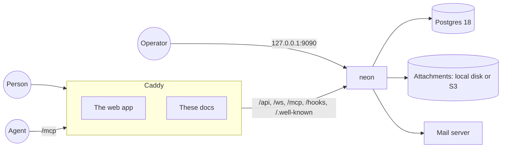
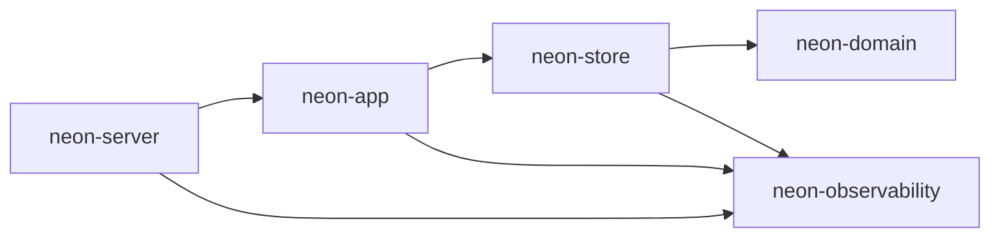
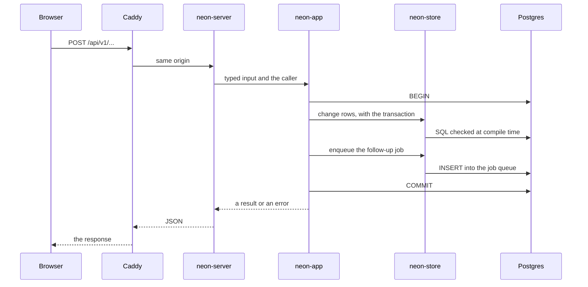

Neon Teamspace is a Rust server, a TypeScript single-page app, and Postgres. The server is
one binary, `neon`: the HTTP API, real-time editing over WebSocket, the MCP endpoint for
agents, and webhooks both ways. In a deployment, Caddy serves the app and these docs
as files and passes everything else to the server, so the browser sees one origin.

## The parts

- **The server** is the `neon` binary. It runs the API, the pages' live documents and the
  job queue's workers in one process, and serves metrics, health and profiles on an internal admin listener that Caddy
  never exposes. It starts its telemetry first, then the admin listener, then connects to
  Postgres and starts the job worker and the HTTP server; it stops them in the reverse
  order, as [Observability](/docs/architecture/observability/#shutdown) describes.
- **Caddy** serves the app and the docs, proxies the server's paths on the same origin, gets
  the TLS certificate, and sets the security headers. It is the web image of the
  [Docker deployment](/docs/self-hosting/install/#with-docker); in development, Vite's server
  passes the same paths on to the server's own port, 8080.
- **Postgres** keeps everything lasting but attachments' bytes: content, settings, sessions
  and the job queue.
- **The blob store** keeps attachments' bytes: a directory of the server's disk, or a bucket
  of an S3-compatible store such as SeaweedFS; see [File storage](/docs/self-hosting/storage/).
- **The mail server** is an SMTP relay of the operator's choice, which the server hands its
  mail to; see [Mail](/docs/self-hosting/mail/).
- **Agents** reach the server's MCP endpoint, `/mcp`, on the same origin; see
  [Agents over MCP](/docs/guides/agents-over-mcp/).

## The crates

The cargo workspace has seven crates: six make the server, and one the updater.

| Crate | What it holds |
|---|---|
| `neon-domain` | Types, validation and permission rules. No I/O, no async, no database. |
| `neon-blocks` | A page's block document: its model, its Yjs form and markdown. No I/O, no async. |
| `neon-store` | The Postgres repositories, with sqlx. |
| `neon-app` | The use cases. They own transactions and define the ports for side effects. |
| `neon-observability` | Logs, metrics, traces, profiles, the admin listener and ordered shutdown. |
| `neon-server` | The `neon` binary: the HTTP API, the WebSockets of real-time sync, the MCP server and the webhooks' endpoints; the adapters for mail, storage and webhooks' deliveries; the command line; and the wiring of it all. |
| `neon-updater` | The `neon-updater` binary, which the Compose file's `updater` profile runs beside the stack: a small HTTP server that updates the stack to a release when the server asks, through the docker CLI and cosign. |

Dependencies point inward. An arrow reads "may depend on", and a crate may use any crate
further in, never one further out:

A crate can use only what its `Cargo.toml` lists, so the compiler holds the direction: code
in `neon-domain` cannot reach the database, because the crate does not depend on sqlx, and
nothing in `neon-store` can call a use case. `neon-blocks` stands alone too, beside the
domain: it depends on yrs and a markdown parser only, and `neon-app` uses it for the live
documents and for import and export, as [Page documents](/docs/architecture/documents/)
describes. `neon-observability`
stands alone.
Any crate but `neon-domain` may use it, and the server installs it as it starts.
`neon-store` uses it to keep the trace context in job rows, `neon-app` to trace and measure
job runs, and `neon-server` for everything else. `neon-updater` stands apart from them all:
it uses none of the other crates, none uses it but the server's tests, which run its routes
to hold the server's updater client to them, and the server speaks to it over HTTP, as
[One-click updates](/docs/self-hosting/upgrading/#one-click-updates) describes.

### Ports

A use case calls the store's repositories directly, with the transaction passed in as
`&mut Transaction`, so the use case decides what commits together. There is no trait over
the repositories: tests run them against a real Postgres, a fresh database for each test.

Traits are kept for side effects outside the database, the **ports**: `Mailer`,
`Broadcaster`, `AccessChanges`, which tells the live documents, the database feeds and the
MCP sessions whose access changed, `RateLimiter`, `WebhookTransport`, and `BlobStore` for
attachments' bytes. `neon-app` declares them, `neon-server` provides the adapters, such
as SMTP and HTTP for webhooks and the HTTP client of the S3 store, and tests use fakes. The
blob store's adapter is `object_store`'s, over local disk or S3, in `neon-app`, which tests
run against a directory and an in-memory store. They are held as `Arc<dyn Trait>`.

## A request's way

A request that changes data takes this way through the crates:

1. Caddy passes the request on, keeping the client's address only when it comes through a
   proxy it trusts.
2. `neon-server`'s HTTP layer opens the request's span, named after its route, and starts
   the HTTP metrics for that route. The span starts a new trace that links to the one the
   request carries, if any, or continues it when `tracing.trust_incoming` is on. The
   handler turns the request into the use case's typed input.
3. The use case in `neon-app` checks the rules in `neon-domain`, opens a transaction, and
   calls the repositories in `neon-store` with it.
4. Work that happens after the request, such as a mail, goes into the job queue in the same
   transaction, with the request's `traceparent`, so the job's run joins the request's
   trace. A rollback leaves no job, and a commit always leaves one; see
   [the job queue](/docs/architecture/data/#the-job-queue).
5. The handler answers with JSON. Errors share one shape, `{"error": {"code", "message"}}`:
   `code` is stable, for programs to act on, and `message` is for people.

## One origin

The app, the docs and the API share one origin. The session cookie then needs no cross-site
settings, the server's origin check has one origin to compare with, and there is no CORS to
configure. Under it:

| Path | Goes to |
|---|---|
| `/api/v1` | The JSON API. Its description is at `/api/v1/openapi.json`. |
| `/ws` | Real-time editing; see [Real-time sync](/docs/architecture/realtime/). |
| `/mcp` | Agents and the people they act for, over MCP; see [Agents over MCP](/docs/guides/agents-over-mcp/). |
| `/hooks/*` | Incoming webhooks, each at `/hooks/in/{token}`; see [Webhooks](/docs/guides/webhooks/#incoming-webhooks). |
| `/.well-known/*` | The OAuth server's metadata, for MCP clients and other programs; see [Connecting apps over OAuth](/docs/guides/oauth/). Any other well-known path gets the server's JSON `404`, so a client that looks for a document the server lacks, such as an OpenID configuration, is told it is not there. |
| `/docs` | These docs. |
| Anything else | The web app. |

The admin listener is not on this origin: it binds `127.0.0.1:9090` by default, apart from
the app's port.

## Reading on

[Data and storage](/docs/architecture/data/), [Observability](/docs/architecture/observability/),
[The web app](/docs/architecture/web/), and the [key decisions](/docs/architecture/decisions/)
behind them.
