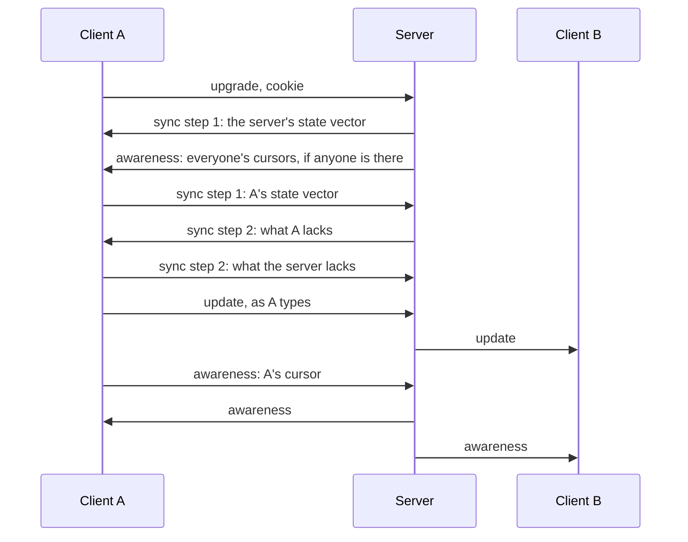

Everyone who has a page open edits one Yjs document. The server keeps it in memory while the
page is open, merges what each connection sends, passes every change on to the others, and
saves it to Postgres. The connection speaks y-websocket's protocol, so the browser uses the
stock `WebsocketProvider` from `y-websocket`, and an agent any client of the same protocol.
What the document holds is in [Page documents](/docs/architecture/documents/).

## Connecting

A page's document is at `GET /ws/pages/{page_id}`, a WebSocket upgrade. y-websocket puts the
room name after the URL it is given, so the page's id is the room:

```ts
import * as Y from "yjs";
import { WebsocketProvider } from "y-websocket";

const doc = new Y.Doc();
const url = `${location.origin.replace(/^http/, "ws")}/ws/pages`;
const provider = new WebsocketProvider(url, pageId, doc);
// BlockNote's collaboration options take this fragment.
const fragment = doc.getXmlFragment("document-store");
```

The server checks the request before it upgrades, in this order:

| Check | Refused with |
|---|---|
| The request names an `Origin`, as browsers always do, and it is not the server's own: `server.public_url`, or the `Host` it was sent to when that is unset. | `403 forbidden` |
| It authenticates as any API request does: the session cookie, or `Authorization: Bearer nw_…` with an API token that has the `read` scope, which every scope brings. | `401 unauthenticated`, or `403 insufficient_scope` |
| The page exists, and the rules let the caller see it. | `404 not_found`, the same for a page that does not exist |
| The caller has fewer than 20 connections open on this server, and the page fewer than 200. | `429 too_many_connections` |
| It is a WebSocket upgrade. | `426 upgrade_required` |

The origin check stops cross-site WebSocket hijacking. The check that guards requests that
change something covers `POST`, `PATCH` and `DELETE`, and an upgrade is a `GET`; without its
own check, a page on another site could open a socket that carries the visitor's cookie. A
client that sends no `Origin` is not a browser, and has no visitor's cookie to misuse.

## The protocol

Each WebSocket message is a binary y-protocols message: sync step 1, sync step 2, an
update, an awareness update, an awareness query or an auth message. The server sends one per
WebSocket message, since y-websocket reads one from each. It reads any number from a message
a client sends, one after another. A text message closes the connection.



The server answers a sync step 1 with everything the client's state vector lacks, which may
be the whole document, so it answers one at a time: one that comes while the answer to the
last still waits to be sent is not answered again, as the client gets that answer and every
update after it. A connection may send one a second, with bursts of 10; y-websocket sends
one as it connects.

Once the server applies an update, it sends what changed to every other client. An update
that needs changes the server does not have, such as one whose author's earlier update never
came, is not kept waiting for them: the server keeps what of it applies, drops the rest, and
closes the connection with `4422`. y-websocket sends a client's updates in order, and one
that reconnects syncs whatever is missing; a document never holds changes that do not
show, which would grow it past its limit unseen. It sends
each awareness change to every client, the sender too, as y-websocket's own server does: the
browser renews its awareness state every 15 seconds and counts the echo as a sign of life.
A client holds the awareness ids it introduced, at most 8, and the server drops entries it
sends for anyone else's, so nobody can move another person's cursor. An awareness state is
at most 8 KiB of JSON, a cursor and a name; a larger one closes the connection with `1009`,
and one that is not JSON with `1007`.

The server writes who the connection is into the `user` field of each state it passes on,
whatever the client put there: the account's `id`, its display name as `name`, and its
`hue`, as the API gives them. Nobody shows under another person's name, and no colour or
other field a client makes up reaches the others' editors, which draw each cursor from its
hue. A state that is not an object, such as `null` for a cursor that left, passes as it is.

```json
{ "user": { "id": "0193a5b2-0000-7000-8000-0000000000a1", "name": "Ada", "hue": 212 }, "cursor": null }
```

A connection may send 20 awareness messages a second, with bursts of 100; past that, the
server drops them rather than pass them on, and the next one tells the same. When a
connection closes, its client's cursors go, and the others are told.

## Viewing and editing

Before the upgrade the server asks the page service what the caller may do with the
document. They edit it when they may edit the page, the page is out of the trash, and their
API token, if they use one, has the `write` scope. Otherwise they view it. A page in the
trash shows only to those who could edit it, and they open its document read-only.

A connection that only views gets the document and every change as it comes. It may send
updates that change nothing, as the stock provider does when it answers the server's sync
step 1 with what it holds, and it may send its awareness, so its cursor and presence show.
An update that adds anything the document lacks, or deletes anything it has not deleted,
closes the connection with `4403`.

## When access changes

The page, workspace and auth services tell the sync service whose access may have changed,
once each change commits: a page moved to another place, trashed, restored, deleted or
purged from the trash, a share added, changed or removed, someone joining or leaving a
teamspace or getting another role there, a teamspace's new access or its deletion, a
member's new role, leaving or removal, a workspace's deletion, and a person signing out,
having a session or API token revoked, changing or resetting their password, or having
their account disabled or given another role. A page placed elsewhere among the same
siblings changes nobody's access, and tells nothing.

The sync service then looks again, at once, at every open connection the change may
concern: the person's, or everyone's, in the change's workspace, and for a change to a page,
those on that page, a page under it, or a page that is gone. It looks at 8 at a time. For
each, it reads the session or API token the connection opened with again, then asks the
rules what its person may do now:

| The person may now | The connection |
|---|---|
| Not use the session or token any more: it ended or expired, or the account was disabled | Closes with `4401`. |
| Not see the page | Closes with `4404`. |
| Only view it, having edited it | Stays open, read-only. The server sends an auth message, permission denied with the reason `read-only`. |
| Edit it, having only viewed it | Stays open and may edit. The server sends an auth message, permission granted. |

y-websocket logs a denied auth message and leaves granted ones alone. The web app's editor
reads them to switch between editing and viewing at once; see
[The web app](/docs/architecture/web/#pages-and-the-editor). A connection the rules let in
just before a change committed, and that joined just after, looks again at its access as it
joins, so no change slips between the two.

Every five minutes the server looks so at every open connection, for what no change tells
of: a session that expired, or a token past its expiry.

## Live documents

The first connection to a page loads its document: the latest snapshot, with the updates
logged after it applied. One task owns each live document and its awareness. Every
connection hands it what its client sends, through one queue, so the document needs no lock
and applies the messages in the order they came. Answers to one client, such as sync step 2,
go to that client's queue, and what everyone must hear goes through the broadcaster, which
puts it in each client's queue.

Thirty seconds after the last connection leaves, the document is saved and unloads. A
connection that arrives meanwhile keeps it loaded, and so does a save that fails, to try
again 30 seconds later.

An [export](/docs/guides/import-export/#exporting) of an open page reads its live document,
through the same queue, so it holds every update applied before it, saved or not. An export
of a page nobody has open reads the snapshot and the updates logged after it, and loads no
live document.

## Saving

An update the server applies waits a quarter of a second, or until 256 KiB of them wait, and
is then logged in `page_updates` with the others in one statement, in order, each with its
author. Consecutive updates of one author merge into one row, so typing logs a row per pause
rather than per key.

Once 500 updates, or 4 MiB of them, are logged after the latest snapshot, and whenever a
document unloads or the server stops, the whole document is saved as a snapshot in one
transaction that:

1. replaces the page's row in `page_snapshots` with the encoded document and its state
   vector, and the number of the last update it holds;
2. deletes the updates it holds from `page_updates`;
3. sets `pages.search_text` to the document's plain text, from its blocks;
4. moves `pages.content_updated_at` forward to the latest change, and names that change's
   author as `last_edited_by`, unless the page's title, icon, cover or style changed later.

Yjs updates commute, so loading applies the snapshot and the updates after it in any order
to the same document. A write that fails is logged and tried again, after half a second at
first and twice as long each time, up to 30 seconds; the document keeps the updates in
memory, in order, meanwhile. A write that finds the page deleted closes the document's
connections with `4404` and saves nothing more.

Nothing logs a document's content: log lines and spans carry the page's id, sizes and
counts.

## Limits

| Limit | Default | Past it |
|---|---|---|
| A message from a client | 4 MiB | The connection closes with `1009`. |
| A document | 16 MiB, its snapshot and the updates logged after it | An update that adds anything closes the connection with `4413`. The server first saves a snapshot, which may show the document smaller than the estimate; updates that only delete are taken. |
| Messages from one connection | 100 a second, with bursts of up to 1000 | The connection closes with `4429`. |
| Messages waiting to be sent to a client | 512, and 24 MiB of them; a message alone in the queue is taken whatever its size | The client fell behind, and the connection closes with `4408`, so it holds up nobody else. |
| Sync step 1 messages from one connection | 1 a second, with bursts of 10; one at a time is answered | The connection closes with `4429`. |
| An awareness state | 8 KiB | The connection closes with `1009`. |
| Awareness messages from one connection | 20 a second, with bursts of 100 | They are dropped. |
| Connections | 20 for one person on this server, 200 for one page | The upgrade is refused with `429`; one of several that came at once closes with `1013`. |
| Sending one message | 30 seconds | The connection closes with `4408`. |
| Silence | Nothing from the client, not even a pong, between two pings; the server pings every 30 seconds | The server drops the connection without a close. |
| Awareness ids per connection | 8 | Entries for more are dropped. |

The server's own pings are WebSocket pings, which browsers answer without telling the page.
y-websocket closes and reconnects a connection on which it got no message for 30 seconds; the
awareness echo keeps that from happening while the page is open.

## Close codes

| Code | Why |
|---|---|
| `1003` | A text message. The protocol is binary. |
| `1007` | A message that is not a y-sync or awareness message, an update that does not decode, or an awareness state that is not JSON. |
| `1009` | A message over the size limit. |
| `1011` | The server could not load or save the document. |
| `1012` | The server is restarting. Reconnect. |
| `1013` | The person or the page has as many connections open as the server takes. |
| `4401` | The session or API token the connection opened with ended, or its account was disabled. |
| `4403` | A change from a connection that may only view the page. |
| `4404` | The person may no longer see the page. |
| `4408` | The client fell behind on what the server sent. |
| `4413` | The change would make the document larger than the server keeps. |
| `4422` | An update that needs changes the server does not have. Reconnect, to sync them. |
| `4429` | Too many messages. |

y-websocket reconnects after any close but 4400 to 4499. A client should stop after `4401`,
which needs a new sign-in, after `4403`, `4404`, `4413` and `1009`, which reconnecting does
not cure, as the same change would be sent again, and after `1003` and `1007`, which mean it
sent what the server cannot read. It should reconnect after `4408` and `4429` after a pause,
and at once after the rest, `4422` included. The web app does so.

## Stopping

On SIGTERM the HTTP server stops taking connections first, so clients cannot reconnect to a
server on its way out. Then every live document closes its connections with `1012` and saves
its snapshot, within 30 seconds, before the database pool closes; a snapshot that cannot be
saved leaves the updates in the log. [Observability](/docs/architecture/observability/#shutdown)
has the whole order.

## Metrics

The sync subsystem's RED metrics, `neon_sync_operations_total` and the others, time three
operations: `load`, `persist`, a batch of updates logged, and `compact`, a snapshot saved.
Beside them:

| Metric | Type | Labels | What it shows |
|---|---|---|---|
| `neon_sync_live_documents` | gauge | | Documents in memory, open or about to unload. |
| `neon_sync_open_connections` | gauge | | Open WebSocket connections. |
| `neon_sync_message_size_bytes` | histogram | `direction`: `in` or `out` | The sizes of the messages connections carry, in buckets from 64 bytes to 16 MiB. |
| `neon_sync_messages_total` | counter | `kind`: `sync_step1`, `sync_step2`, `update`, `awareness`, `awareness_query`, `auth`, `other` | Messages clients sent. |
| `neon_sync_disconnects_total` | counter | `cause`: `client`, `unresponsive`, or a close reason, such as `read_only` or `too_slow` | Connections ended. |

## Database feeds

A database's rows and their values are plain data rather than a Yjs document: each change is
saved as it is made, the last of two to one property winning. `GET /ws/databases/{id}` tells
everyone who shows the database of each change once it is saved, so they apply it to what
they show. The upgrade is checked as a page's, in the same order, the database standing for
the page, with its own limit of connections.

Each message is a JSON text message, an object whose `type` says what changed, with the
database's `database_id`:

| `type` | Fields | Sent when |
|---|---|---|
| `ready` | `access`: `edit` or `view` | First, once the connection hears every change. |
| `access` | `access` | What the person may do with the database changed. |
| `row_created` | `row`: the row as a query lists it, without `access` and `group` | A row was added. |
| `row_updated` | `row_id`; `values`, those that changed, by property id, `null` for those cleared; `title` when it changed; `last_edited_at`, `last_edited_by` | A row's values or title changed. |
| `row_moved` | As `row_updated`, with `position`, the row's new key among the rows | A row was placed elsewhere, or moved to another group, whose value is then among `values`. |
| `row_trashed` | `row_id` | A row went to the trash. |
| `row_restored` | `row` | A row came back from it. |
| `schema_changed` | | A property was added, changed, placed or deleted. Read the database again. |
| `view_changed` | `view_id`, `deleted` | A view was added, changed, placed, duplicated or deleted. |

```json
{"type": "row_updated", "database_id": "0193a5b2-0000-7000-8000-0000000000d1",
 "row_id": "0193a5b2-0000-7000-8000-0000000000e1",
 "values": {"0193a5b2-0000-7000-8000-0000000000f2": "0193a5b2-0000-7000-8000-0000000000f5"},
 "last_edited_at": "2026-11-22T12:00:00Z", "last_edited_by": "0193a5b2-0000-7000-8000-0000000000a1"}
```

Guests hear the same changes without the people: the values of person properties are left
out, and so are who made and changed rows. Changes go to two rooms of the broadcaster, one
for members and one for guests, so each hears its own version.

Changes to one row's values are saved one at a time, each holding the row until it is
saved, and each is told right after it is saved. Two changes to one row saved within moments
of each other by two requests may still be told in the other order, as nothing orders the
telling of two requests: a client that must be sure of a row reads it again with
`GET /api/v1/rows/{id}`, as it does when it reconnects.

Nothing a connection missed before it opened is sent: a client reads the database, and
queries it, as it connects and again whenever it reconnects, then applies each message after
`ready`. A client has nothing to send. What it sends is read and dropped; more than 4 KiB in
one message closes it with `1009`, and more than 5 messages a second, with bursts of 20,
with `4429`.

When someone's access changes, their feeds are looked at again as their documents are,
[above](#when-access-changes): a feed closes with `4401` once its session or token ended,
and with `4404` once the person may no longer see the database. One whose access changed
between editing and viewing stays open and is sent an `access` message; one whose role
changed between guest and member moves to the other room. Every five minutes every feed is
looked at so again.

| Limit | Default | Past it |
|---|---|---|
| Connections | 20 for one person on this server, 200 for one database | The upgrade is refused with `429`; one of several that came at once closes with `1013`. |
| Messages waiting to be sent to a client | 256, and 8 MiB of them | The client fell behind, and the feed closes with `4408`; it reconnects and reads afresh. |
| Sending one message | 30 seconds | The feed closes with `4408`. |
| Silence | Nothing from the client, not even a pong, between two pings; the server pings every 30 seconds | The server drops the connection without a close. |

A feed closes with the codes of [Close codes](#close-codes) that apply to it: `1009`, `1012`
when the server stops, `1013`, `4401`, `4404`, `4408` and `4429`. A client should stop after
`4401` and `4404`, and reconnect after the others, after a pause for `4408` and `4429`.

Its metrics are `neon_databases_open_connections`, a gauge of the open feeds,
`neon_databases_disconnects_total`, a counter by `cause` as for documents, and
`neon_databases_events_total`, the changes told, by `type`.

## One process

The broadcaster, which puts a document's and a database's messages in their clients' queues,
is a port with one adapter, for clients connected to this process. Running a second server process would need
an adapter that carries the messages between processes, and the documents themselves held
in one place; [Key decisions](/docs/architecture/decisions/#one-process-no-redis) explains why
that waits.
