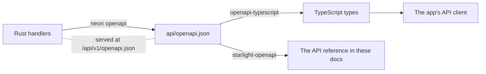

The web app is a single-page app in `web/`: React and TypeScript, built with Vite into static
files that Caddy serves. Bun installs its packages and runs its scripts. It talks to the
server only through the JSON API under `/api/v1` and, as they arrive, the WebSocket at `/ws`.

## The stack

| Part | What it does |
|---|---|
| React, TypeScript, Vite | The app and its build. |
| TanStack Router | Routes, typed: a link to a route that does not exist, or with the wrong parameters, is a type error. |
| TanStack Query | Server state: what the API returned, cached, shared between the components that need it, and refetched when it goes stale. |
| shadcn/ui on Radix | Components. Radix brings their behaviour, focus and keyboard handling; shadcn's code is copied into the app, so it is the app's own to change. |
| Tailwind v4 | Styles, with every colour a CSS variable, so a theme is a set of variables and switching it restyles the app without a reload. |
| `openapi-typescript`, `openapi-fetch` | The typed API client; see below. |
| oxlint, prettier | Lint and formatting. |
| vitest, MSW | Tests of pages and components against a stand-in API. |

**Planned.** The editor is BlockNote, with its shadcn variant, on the page's Yjs document.
Its core is licensed MPL-2.0. Its XL packages are licensed GPL-3.0 and are not used; see
[the license](/docs/architecture/decisions/#the-license).

The interface is in English, with every string kept in one module, so a translation can
follow without hunting through components. The app is responsive and works on a phone's
browser; there are no native apps.

## Types from the server

The API is described code first. The server declares each route together with its OpenAPI
entry, and `neon openapi` writes the description to `api/openapi.json`, which is
committed. Everything else follows from that file:



`openapi-typescript` turns the description into TypeScript types, which are committed too,
and `openapi-fetch` checks each call against them. A path the server does not have, a missing
parameter or a field it does not send is a type error in the app. CI fails when the committed
description is stale against the server, or the types against the description, so the three
cannot drift apart.

## The theme model

Each person chooses three things, and the app's colours follow from them:

- A **palette**: Nothing, Soft or Warm.
- A **mode**: system, light or dark. System follows the operating system's setting, and
  changes with it.
- An **accent hue**, from 0 to 359 degrees: on a free slider, or one of the presets around
  the wheel. Blue, 250, is the default.

The defaults are Nothing in system mode. Until accounts exist the choice is kept in the
browser; **planned**, it is saved with the account and follows the person to every browser.
The theme is applied before the first paint, so a dark page never flashes white.

### Palettes

| Palette | Light | Dark |
|---|---|---|
| Nothing | Pure white, black text, light grey rules. | Pure black, white text, dark grey rules. |
| Soft | White, with a cool grey for raised surfaces. | Blue-tinted near-blacks, `#0e1013` and `#16191e`. |
| Warm | Paper, an off-white with a little yellow. | Warm charcoal. |

All three share the same design language: a dot-grid ground, 1px rules, pill-shaped
buttons and chips, flat surfaces with no shadows, and four repeating shapes of content: a
key and value row, a chip, a step node, and a figure with its caption. Nothing has square
corners, as its only curves are circles and pills; Soft and Warm round theirs a little.

### The accent

The accent is a colour in OKLCH, a colour space in which equal steps of lightness look
equal across hues:

```css
--accent: oklch(var(--accent-l) var(--accent-c) var(--accent-h));
```

Only the hue, `--accent-h`, is the person's. The lightness and chroma are fixed for each
palette and mode, at values where accent text on the page, and text on an accent fill, keep a
contrast of at least 4.5:1 at every hue. Any hue can be chosen without making the app hard to
read.

In light modes the accent sits dark and moderate. In dark modes it is brighter and more
saturated, which is what reads as neon on a dark ground, and there, and only there, the
elements that carry a hue glow: focus rings, live cursors, presence dots and the active
card's border. Everything else stays flat.

### Hues of things

**Planned**, as the things they colour arrive. Users, agents, integrations, teamspaces,
workspaces and databases each have a hue of their own, worked out from their ID:

1. Take the UUID's 16 bytes.
2. Hash them with 32-bit FNV-1a.
3. The hue is the hash modulo 360.

Every browser and the server get the same hue for the same ID, with nothing to choose, store
or sync, and a person's cursor, avatar and mentions share one colour everywhere. Only the hue
comes from the ID: lightness and chroma come from the palette and mode, as for the accent, so
the contrast holds whatever hue an ID lands on. A teamspace can pin a hue of its own
instead.

## Fonts

The app's text is set in the system's own sans-serif, the stack Notion uses: San Francisco on
Apple systems, Segoe UI on Windows, and the platform's default elsewhere. Nothing is
downloaded for it.

- **Per person**, the interface's font is Default or Mono.
- **Per page**, **planned**: Default, Serif or Mono, as in Notion, and small text and full
  width. Serif is the system's serif stack.
- **Mono** is iA Writer Mono, licensed under the SIL Open Font License and bundled with the
  app, so it is the same on every system and served from the same origin.

## These docs

These docs are [Starlight](https://starlight.astro.build/), in `docs/`, built into static
files and served by Caddy at `/docs`. They take the Nothing palette, in light and dark, with
the default accent.

- Diagrams are Mermaid, drawn into inline SVG as the docs build, by a headless Chromium.
  A page carries no script for them, and they follow the theme.
- The [API reference](/docs/reference/api/) is generated from `api/openapi.json` by
  `starlight-openapi`. The [settings reference](/docs/reference/settings/) is generated from
  the server's settings registry by `neon settings docs`.
- Search is Pagefind's, an index built with the docs that runs in the browser.
- Their Content-Security-Policy allows the pages' few inline scripts by their hashes, worked
  out after each build, and no other inline script.
- Every link between pages, and every anchor, is checked on each build.
