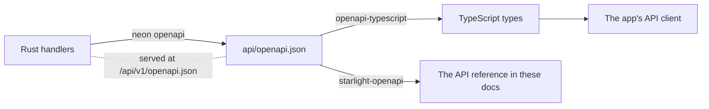

The web app is a single-page app in `web/`: React and TypeScript, built with Vite into static
files that Caddy serves. Bun installs its packages and runs its scripts. It talks to the
server only through the JSON API under `/api/v1` and the WebSockets of
[real-time sync](/docs/architecture/realtime/), under `/ws`, which sync a page and tell of a
database's changes.

## The stack

| Part | What it does |
|---|---|
| React, TypeScript, Vite | The app and its build. |
| TanStack Router | Routes, typed: a link to a route that does not exist, or with the wrong parameters, is a type error. |
| TanStack Query | Server state: what the API returned, cached, shared between the components that need it, and refetched when it goes stale. |
| TanStack Virtual | Long lists drawn in part: a database's table, list and board columns draw only the rows near the screen. |
| shadcn/ui on Radix | Components. Radix brings their behaviour, focus and keyboard handling; shadcn's code is copied into the app, so it is the app's own to change. |
| Tailwind v4 | Styles, with every colour a CSS variable, so a theme is a set of variables and switching it restyles the app without a reload. |
| `openapi-typescript`, `openapi-fetch` | The typed API client; see below. |
| oxlint, prettier | Lint and formatting. |
| vitest, MSW | Tests of pages and components against a stand-in API. |

The editor is BlockNote, with its shadcn variant, on the page's Yjs document; see
[Pages and the editor](#pages-and-the-editor). Its core is licensed MPL-2.0. Its XL packages
are licensed GPL-3.0 and are not used; see [the license](/docs/architecture/decisions/#the-license).

The interface is in English, with every string kept in one module, so a translation can
follow without hunting through components. The app is responsive and works in a phone's
browser.

**Planned.** Desktop and mobile apps, as thin [Tauri](https://tauri.app) shells around this
same app. A person enters their server's address, as in Bitwarden's apps, and the shell loads
the web UI that server serves, so an app is never out of step with its server. No app-store
release is planned yet.

## Types from the server

The API is described code first. The server declares each route together with its OpenAPI
entry, and `neon openapi` writes the description to `api/openapi.json`, which is
committed. Everything else follows from that file:



`openapi-typescript` turns the description into TypeScript types, which are committed too,
and `openapi-fetch` checks each call against them. A path the server does not have, a missing
parameter or a field it does not send is a type error in the app. The server's tests,
`cargo test`, fail when the committed description no longer matches its routes, and the
app's checks, `bun run check` in `web/`, fail when the committed types no longer match the
description, so the three cannot drift apart unnoticed.

## Signing in

The app and the API share an origin, so the browser sends the session cookie with every
request and its `Origin` header satisfies the server's check on requests that change
something; the app needs no token of its own. The pages are in two layouts: the shell, with
the sidebar, for everything that needs someone signed in, and a centred card for signing in
and up, the mailed links and asking to join. [Signing in and
accounts](/docs/guides/signing-in/) describes them.

- Before any page of the shell loads, the app asks `GET /api/v1/account/me` who is signed
  in. A 401 means nobody, and leads to `/login` with the page as `next`. Sign-in goes back
  there only when `next` is a path of this origin.
- A request that later answers 401 `unauthenticated` means the session ended, and does the
  same, whatever page sent it. A 401 for a wrong password is the form's to show.
- A 403 `forbidden` makes the app ask again who is signed in, and read the list of
  workspaces, with the roles in them, again, so a role taken away, on the instance or in a
  workspace, shows at once; the admin pages then say they are not allowed. After a refused
  change, every workspace's data is read again. After a refused read, only the data of a
  workspace where the role did change: reading again what was just refused, with nothing
  changed, would be refused again, and start the same again. A read already on its way is
  waited for, not sent again.
- A 429 is shown with the wait its `Retry-After` gives. Answers the server chose, any 4xx,
  are never retried.
- One-time tokens in mailed links, and an invite link's code, are taken out of the address
  as their page opens, by replacing the history entry, so they stay out of the browser's
  history.
- Signing in or out drops everything the previous user's requests left in memory: their
  queries, and every mutation with what it sent and got back. A mutation leaves the cache
  as soon as no page shows it in any case, so a password, a new token's secret or an
  invite code is kept only while its page is open.

Every form checks what the server would refuse, a password's length from
`GET /api/v1/auth/config` included, before sending it, and shows the server's own message
beside the field it is about when it disagrees. The API calls are all in `web/src/api`, one
module each for auth, the account, the admin pages, workspaces, teamspaces, pages and
databases.

## Workspaces

A workspace's pages hang under `/w/{slug}`. The app finds the slug in the user's own list of
workspaces, `GET /api/v1/workspaces`, and asks for the rest by the workspace's id, as the
API takes ids only. A slug not in the list is **Workspace not found**, whether no workspace
has it or the user is not in it. [Workspaces and teamspaces](/docs/guides/workspaces/)
describes the pages.

- The workspace used last is kept in `localStorage`, by account and by the workspace's id,
  which outlives a new slug; `/` opens it while the user is still in it.
- Each workspace's data is cached under its own key, so a change to who is in it refreshes
  all of it at once. A `404 not_found` from a workspace's data reads the list again, as the
  user may have been removed from it.
- `web/src/lib/workspace-rules.ts` repeats the server's [permissions](/docs/reference/permissions/)
  only to decide which controls to show; the server decides.
- An invite link's token is moved out of the address into the tab's `sessionStorage`, which
  outlives signing in on the way, and is dropped once the link is used or turns out not to
  work. A preview asks what the link admits to without using it, through
  `POST /api/v1/workspace-invite-links/preview`.

## Pages and the editor

A page is at `/w/{slug}/p/{id}`, and the workspace's trash at `/w/{slug}/trash`.
[Editing pages](/docs/guides/editing-pages/) describes them. The calls are in
`web/src/api/pages.ts`, cached under the workspace's key like the rest of its data:

- Each tree, a teamspace's, the private and the shared one, is read whole, part after part
  when it has more than 1000 pages, and the sidebar builds its rows from the list.
- A change to a page's place, a move, a trash, a restore, reads the trees, the favorites,
  the trash and every page read again, as the pages under it go along.
- A title is shown in the trees, the favorites and the ways down to pages as it is typed,
  by writing it into those cached lists, and saved over `PATCH /api/v1/pages/{id}` once
  typing pauses for half a second, or as the field is left.
- An import sends its file as a form to `POST /api/v1/workspaces/{id}/pages/import`, after
  checking its name and size, then reads the trees again. An export reads the file as a blob
  and saves it through a link to an object URL, named after its `Content-Disposition`, so
  the app can show the server's message when it refuses; the file is saved from the request
  itself, even once the menu that asked is gone.
- `web/src/lib/page-rules.ts` repeats the page rules only to decide which controls show.
- The page trees' open pages, folded sections and the page being dragged are kept while the
  app runs, shared by the sidebar's column and its drawer. The folded sections are also kept
  in the browser's local storage, under `neon.folded.` and the account's id, so each person
  sharing a browser finds theirs folded after a reload; where storage is refused, they stay
  folded for the session.

Where the main pointer is coarse, each panel open over a page, the drawer, a sheet, a dialog
or the comments, has an entry in the browser's history (`lib/panel-history.ts`), as a phone's
back gesture goes back in the history and would leave the page otherwise. The entry is at the
page's address, and its state lists the panels open in it. Leaving it closes the panel, and
forward to it opens it again; a panel closed another way goes back past its entry, and a
navigation from it takes the place of the panels' entries, so none is left to step through.
The entries keep the scroll position of the page's entry, under the router's
`getScrollRestorationKey`. With a mouse the history is as it was. A row beside its database is
in the address already, as `?peek=`; on a touch screen its **Close** goes back to the
database's entry rather than adding one.

The editor is loaded only with a page: BlockNote, ProseMirror and Yjs make one chunk of
about 1.2 MB, apart from the rest of the app. It binds BlockNote to the page's Yjs
document, to the `XmlFragment` named `document-store` that
[Page documents](/docs/architecture/documents/) describes, and syncs it with the stock
`y-websocket` provider:

- It connects to `/ws/pages/{id}` on the app's own origin, `wss:` over HTTPS, so the session
  cookie goes with the upgrade and the Content-Security-Policy's `connect-src 'self'` covers
  it.
- The y-sync protocol carries the document, and awareness carries each person's cursor and
  presence: their name, their id, their hue and their kind, and for an agent the name of
  the person it acts for, which the server writes into each state itself. The app still
  cleans every state it gets before the editor reads it (`cleanState` in `cursor.ts`): it
  keeps the name, the id, the hue, an agent's or integration's kind and owner, and the
  cursor's two positions, checked, and makes the selection's colour from the hue, as
  y-prosemirror writes that colour into a style attribute as it finds it. An agent's cursor
  and its place among who is here read `Scout · via Ada`.
- Tabs do not sync with each other through a `BroadcastChannel`, as the provider can, so
  every change goes through the server and its checks.
- Nothing can be typed until the server sent the document once, nor once it ended the
  connection for good. A viewer's editor never takes input.
- The server's auth messages turn the editor read-only, permission denied, or back,
  permission granted, as access changes, and the app reads the page again; y-websocket on
  its own only logs a denial.
- After a close, `afterClose` in `connection.ts` decides from the code. 4408 and 4429, a
  client that fell behind or sent too much, are tried again after a pause of a second,
  doubled each time up to 30 seconds. 1009 and 4413, a change too large, 4401, 4403, 4404,
  and the codes of a message the server could not read stop it: sending the same again
  would be refused again, so the app says why and reads the page again, and **Reconnect**
  starts from a new copy of the document. Any other close is tried again at once, with
  changes kept until the connection is back.
- A paste whose text, with what its blocks cost, comes to more than 3 MiB is refused
  before it reaches the document (`paste.ts`), as the server takes 4 MiB at once.
- Files go through BlockNote's `uploadFile` hook, whether picked in a block's panel, pasted
  or dropped: each is uploaded to the page as the kind of its block (`api/files.ts`), and
  the block keeps the path the server answers, `/api/v1/files/{id}`, which the editor loads
  on the same origin with the session. An upload the server refuses leaves its block empty
  and shows why above the editor. A cover image is uploaded the same way, then set as the
  page's `cover_image`, and drawn as the band's background.
- The editor's schema (`schema.ts`) is BlockNote's default blocks and the app's database
  block, and its default inline content and the app's mention, each made from its config in
  `custom-blocks.ts`, as [Page documents](/docs/architecture/documents/#block-types)
  describes. A mention draws someone by the name the workspace's members list gives them
  now, an agent with its owner, and a page as a link. The block draws the
  database it names with the same views as its own page, compact; see
  [Databases](#databases). The slash menu is BlockNote's, with a **Database** item beside its
  table that makes an inline database under the page and gives its id to a new block. So is
  the emoji menu, which `:` opens only where it starts a word, and which closes as soon as
  what follows it starts with anything but a letter, so a time such as `15:00` opens
  nothing.
- Where the main pointer is coarse, `(pointer: coarse)`, the editor has neither BlockNote's
  side menu nor its formatting toolbar: `mobile-toolbar.tsx` does what they do, from a bar
  fixed to the bottom of the visual viewport, so above an on-screen keyboard whether the
  browser covers the page with it or resizes the page, and scaled back to its own size when
  the page is zoomed (`visual-viewport.ts`). Its actions are BlockNote's API
  (`toolbar-actions.ts`); a press on it keeps the focus in the content, and the caret is
  scrolled clear of it as it moves. ProseMirror leaves a tap to the browser, which puts the
  caret in the nearest text, so a tap on a block without text selects that block itself. The
  menus `/`, `@` and `:` open keep that much more room at the window's bottom while it shows
  (`floating.ts`).
- Undo and redo go through y-prosemirror's undo manager, which ends with the editor's view.
  So the view is mounted once: the comment highlights' extension is among the editor's
  options rather than registered after, and whether the editor takes input is set on its
  read-only extension, as a change to the view's `editable` prop mounts it afresh. React's
  strict mode mounts it twice in development, where undo is lost for that reason.

The page's comments live beside the editor (`web/src/components/comments/`), read from
`GET /api/v1/pages/{id}/comments` a part at a time: every part of the open threads, so each
is highlighted, and the resolved ones a part at a time as the panel shows them. When the
page's connection, opened with `?comments=true`, says a thread changed, in its message of type
`100`, the app reads that thread alone, `GET /api/v1/threads/{id}`, and puts it in its place
in the lists, or takes it out once it is gone; a change made here puts the thread it answers
with in place the same way. Once the connection comes back after a break, every list is read
again, as what changed meanwhile went untold. A long thread shows its first comment and its
latest; the replies between come from `GET /api/v1/threads/{id}/comments` on asking.

- The highlights are a ProseMirror plugin (`comment-highlights.ts`), registered on the
  editor once it is made. It turns each open inline thread's two Yjs relative positions into
  a decoration, through y-prosemirror's binding, whenever the threads or the document change
  from elsewhere, and maps the decorations through the user's own edits in between. A new
  thread's positions come from the selection the same way, or from the browser's selection in
  an editor that takes no input.
- The panel is an `aside` beside the page rather than a dialog, so the page stays usable;
  focus moves into it as it opens and back to its button as it closes. The field of a
  comment is a combobox: `@` opens the list of people and pages to mention, which
  `aria-activedescendant` walks without leaving the field.
- `@` in the editor is a BlockNote suggestion menu over the same search, which inserts the
  mention as inline content.

The inbox's live feed, `/ws/inbox` (`inbox-feed.ts`), stays open while the signed-in shell
shows. Each message reads the inbox again, its parts, its count and the invitations, as the
feed tells only that something changed; it reconnects as the page's connection does, and
stops once the session ended.

BlockNote's own colours are replaced with the theme's in `web/src/styles/editor.css`, for
every palette and mode: its `--bn-` variables take the palette's tokens, its text and
highlight colours sit at the accent's lightness and chroma at fixed hues, and its shadcn
menus use the app's shadcn variables, which Tailwind generates for its components too.
Others' cursors carry their hue the way other elements do, with `data-hue` and
`--accent-h`, so each is drawn at the reader's own lightness and chroma, and glows in dark
mode. The tint over the text someone selects is the one colour drawn outside the theme:
y-prosemirror writes it as an sRGB colour, which the app derives from their hue.

## Databases

A database's page, a row's page and a database block all draw the same components, in
`web/src/components/databases/`, on the calls in `web/src/api/databases.ts`, cached under the
workspace's key:

- The database, its properties and its views are one query. Each view's rows are another,
  every part of `POST /api/v1/databases/{id}/query` read in turn: the server filters, sorts
  and groups them, so the app never does, and a database holds at most 10,000 rows.
- A change shows at once: a value is written into every view's rows and the row's own query
  before the server answers, a card moves to its column, a view's settings change in place.
  Shortly after, every view's rows are read again, once for a burst of changes, so each row
  settles where the server's filter, sorts and groups put it. A refused change reads them
  again at once.
- A table, a list and each column of a board draw only the rows near the screen as the page
  scrolls (`windowed.ts`), the rest kept as space, and a row is drawn again only when it
  changes; so a view of the 10,000 rows a database holds is as quick as one of a few.
- `web/src/lib/database-rules.ts` repeats the server's rules for what the app offers: the
  operators of each type, the columns a view shows, how values read, how a card's move
  changes a row. The server checks everything again.
- The feed, `web/src/api/database-feed.ts`, is one WebSocket per database for the whole tab,
  to `/ws/databases/{id}`, shared by everything that shows the database. It applies each
  message to the cache: a row's values and title, a row added, moved or trashed, the schema
  or a view to read again. On `ready`, as it connects and again as it reconnects, it reads the
  database and its rows afresh, beginning again any read already on its way, as that may have
  begun before the feed heard every change. It stops on 4401 and 4404, tries again after a
  pause for 1013, 4408 and 4429, and soon after any other close, as
  [Real-time sync](/docs/architecture/realtime/#database-feeds) asks. It closes a moment after
  nothing shows the database any more, and the next view of it opens it afresh.
- A change the server refuses shows above the views, named by its code where one says more
  than the server's words alone: `too_many_rows`, and `limit_reached`, as for a row's values
  past 64 KiB. A row seen only through its own share comes without its `database_id`, so its
  page shows what every row has rather than the database's properties.
- Guests read no member ids, so for them the app offers no way to set people: person values
  show without an editor, a filter on people compares with `me` alone, a person property
  keeps its type, and a card stays in its person's column, as the server would refuse each.
- Cards and columns move with pointer events rather than the browser's drag and drop, so a
  drag inside a page's editor stays out of ProseMirror's own, and each has a menu that does
  the same from the keyboard and on touch screens.
- A row opens beside its database, in a panel named by the address's `peek`, from 64rem wide
  up, and in place of it below. A database's page names the view in view in `view`.
- A date property's format is the reader's, kept in `localStorage` by property, as the server
  keeps no such setting.

## The theme model

Each person chooses three things, and the app's colours follow from them:

- A **palette**: Nothing, Soft or Warm.
- A **mode**: system, light or dark. System follows the operating system's setting, and
  changes with it.
- An **accent hue**: by default the hue of the workspace in view, so each workspace looks
  like itself to everyone in it; or one of the person's own, from 0 to 359 degrees, on a
  free slider or one of the presets around the wheel.

The defaults are Nothing in system mode, with the workspace's accent. The choice is kept with
the account, at `/api/v1/account/preferences`, so it follows the person to every browser:
signing in loads it, and each change saves it, once a slider drag stops. An `accent_hue` of
`null` there is the workspace's. The browser keeps a copy too, which the next visit applies
before the first paint, so a dark page never flashes white.

Without an accent of their own, a person sees the app in the hue of the workspace the sidebar
shows: the one in view, or, on pages outside any such as their account's, the one they used
last. In no workspace, it is a blue, hue 250. The browser keeps that hue for the next first
paint too.

### Palettes

| Palette | Light | Dark |
|---|---|---|
| Nothing | Pure white, black text, light grey rules. | Pure black, white text, dark grey rules. |
| Soft | White, with a cool grey for raised surfaces. | Blue-tinted near-blacks, `#0e1013` and `#16191e`. |
| Warm | Paper, an off-white with a little yellow. | Warm charcoal. |

All three share the same design language: a dot-grid ground, 1px rules, pill-shaped
buttons and chips, flat surfaces with no shadows, and four repeating shapes of content: a
key and value row, a chip, a step node, and a figure with its caption. Nothing has square
corners, as its only curves are circles and pills; Soft and Warm round theirs a little.

### The accent

The accent is a colour in OKLCH, a colour space in which equal steps of lightness look
equal across hues. In the app's CSS it is `--neon`:

```css
--neon: oklch(var(--accent-l) var(--accent-c) var(--accent-h));
```

shadcn's `--primary` and `--ring` take it. shadcn's own `--accent` is not the accent: it is
the neutral surface under a hovered item.

Only the hue, `--accent-h`, is the person's. The lightness and chroma are fixed for each
palette and mode, at values where accent text on the page, and text on an accent fill, keep a
contrast of at least 4.5:1 at every hue. Any hue can be chosen without making the app hard to
read.

In light modes the accent sits dark and moderate. In dark modes it is brighter and more
saturated, which is what reads as neon on a dark ground, and there, and only there, the
elements that carry a hue glow: focus rings, live cursors, presence dots and the active
card's border. Everything else stays flat.

Page covers take their own pair, `--cover-l` and `--cover-c`: the accent's values in light
modes, and a mid lightness with less chroma in dark modes, where a band at the accent's text
lightness would glare across the top of the page.

### Hues of things

Users, workspaces, teamspaces, agents and integrations each have a hue of their own, worked
out from their ID; databases have none yet, and theirs is **planned**:

1. Take the UUID's 16 bytes, in order. Only the canonical form, 8-4-4-4-12 hex digits in
   any case, counts as a UUID; any other ID is hashed as its UTF-8 text.
2. Hash them with 32-bit FNV-1a, offset basis `0x811c9dc5`, prime `0x01000193`.
3. The hue is the hash modulo 360.

Every browser and the server get the same hue for the same ID, with nothing to choose, store
or sync, and a person's cursor, avatar and mentions share one colour everywhere. The web
app's `hueFor` and the server's `hue_for` share the test vectors in
`web/src/lib/hue-vectors.json`, and both test suites check every one. Only the hue comes from
the ID: lightness and chroma come from the palette and mode, as for the accent, so the
contrast holds whatever hue an ID lands on.

A user, workspace, teamspace, agent or integration can pin a hue of its own instead. The API
sends both: `hue`, the one to draw, and `hue_override`, the pinned one when there is one.

## Fonts

The app's text is set in the system's own sans-serif, the stack Notion uses: San Francisco on
Apple systems, Segoe UI on Windows, and the platform's default elsewhere. Nothing is
downloaded for it.

- **Per person**, the interface's font is Default or Mono.
- **Per page**: Default, Serif or Mono, as in Notion, and small text and full width. Serif
  is the system's serif stack. The page's title and content take its font.
- **Mono** is iA Writer Mono, licensed under the SIL Open Font License and bundled with the
  app, so it is the same on every system and served from the same origin.

## These docs

These docs are [Starlight](https://starlight.astro.build/), in `docs/`, built into static
files and served by Caddy at `/docs`. They take the Nothing palette, in light and dark, with
the default accent.

- Diagrams are Mermaid, drawn into inline SVG as the docs build, by a headless Chromium.
  A page carries no script for them, and they follow the theme.
- The [API reference](/docs/reference/api/) is generated from `api/openapi.json` by
  `starlight-openapi`. The [settings reference](/docs/reference/settings/) holds the table
  `neon settings docs` prints from the server's settings registry. `make docs-gen` writes it,
  and a server test fails when the committed page is stale.
- Search is Pagefind's, an index built with the docs that runs in the browser.
- Their Content-Security-Policy allows the pages' few inline scripts by their hashes, worked
  out after each build, and no other inline script.
- Every link between pages, and every anchor, is checked on each build, except links into
  the generated API reference.
