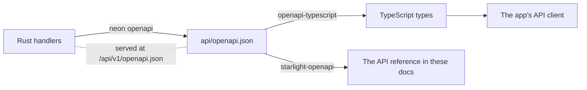

The web app is a single-page app in `web/`: React and TypeScript, built with Vite into static
files that Caddy serves. Bun installs its packages and runs its scripts. It talks to the
server only through the JSON API under `/api/v1` and, as they arrive, the WebSocket at `/ws`.

## The stack

| Part | What it does |
|---|---|
| React, TypeScript, Vite | The app and its build. |
| TanStack Router | Routes, typed: a link to a route that does not exist, or with the wrong parameters, is a type error. |
| TanStack Query | Server state: what the API returned, cached, shared between the components that need it, and refetched when it goes stale. |
| shadcn/ui on Radix | Components. Radix brings their behaviour, focus and keyboard handling; shadcn's code is copied into the app, so it is the app's own to change. |
| Tailwind v4 | Styles, with every colour a CSS variable, so a theme is a set of variables and switching it restyles the app without a reload. |
| `openapi-typescript`, `openapi-fetch` | The typed API client; see below. |
| oxlint, prettier | Lint and formatting. |
| vitest, MSW | Tests of pages and components against a stand-in API. |

**Planned.** The editor is BlockNote, with its shadcn variant, on the page's Yjs document.
Its core is licensed MPL-2.0. Its XL packages are licensed GPL-3.0 and are not used; see
[the license](/docs/architecture/decisions/#the-license).

The interface is in English, with every string kept in one module, so a translation can
follow without hunting through components. The app is responsive and works in a phone's
browser.

**Planned.** Desktop and mobile apps, as thin [Tauri](https://tauri.app) shells around this
same app. A person enters their server's address, as in Bitwarden's apps, and the shell loads
the web UI that server serves, so an app is never out of step with its server. No app-store
release is planned yet.

## Types from the server

The API is described code first. The server declares each route together with its OpenAPI
entry, and `neon openapi` writes the description to `api/openapi.json`, which is
committed. Everything else follows from that file:



`openapi-typescript` turns the description into TypeScript types, which are committed too,
and `openapi-fetch` checks each call against them. A path the server does not have, a missing
parameter or a field it does not send is a type error in the app. The server's tests,
`cargo test`, fail when the committed description no longer matches its routes, and the
app's checks, `bun run check` in `web/`, fail when the committed types no longer match the
description, so the three cannot drift apart unnoticed.

## Signing in

The app and the API share an origin, so the browser sends the session cookie with every
request and its `Origin` header satisfies the server's check on requests that change
something; the app needs no token of its own. The pages are in two layouts: the shell, with
the sidebar, for everything that needs someone signed in, and a centred card for signing in
and up, the mailed links and asking to join. [Signing in and
accounts](/docs/guides/signing-in/) describes them.

- Before any page of the shell loads, the app asks `GET /api/v1/account/me` who is signed
  in. A 401 means nobody, and leads to `/login` with the page as `next`. Sign-in goes back
  there only when `next` is a path of this origin.
- A request that later answers 401 `unauthenticated` means the session ended, and does the
  same, whatever page sent it. A 401 for a wrong password is the form's to show.
- A 403 `forbidden` makes the app ask again who is signed in, and read the list of
  workspaces, with the roles in them, again, so a role taken away, on the instance or in a
  workspace, shows at once; the admin pages then say they are not allowed. After a refused
  change, every workspace's data is read again. After a refused read, only the data of a
  workspace where the role did change: reading again what was just refused, with nothing
  changed, would be refused again, and start the same again. A read already on its way is
  waited for, not sent again.
- A 429 is shown with the wait its `Retry-After` gives. Answers the server chose, any 4xx,
  are never retried.
- One-time tokens in mailed links, and an invite link's code, are taken out of the address
  as their page opens, by replacing the history entry, so they stay out of the browser's
  history.
- Signing in or out drops everything the previous user's requests left in memory: their
  queries, and every mutation with what it sent and got back. A mutation leaves the cache
  as soon as no page shows it in any case, so a password, a new token's secret or an
  invite code is kept only while its page is open.

Every form checks what the server would refuse, a password's length from
`GET /api/v1/auth/config` included, before sending it, and shows the server's own message
beside the field it is about when it disagrees. The API calls are all in `web/src/api`, one
module each for auth, the account, the admin pages, workspaces and teamspaces.

## Workspaces

A workspace's pages hang under `/w/{slug}`. The app finds the slug in the user's own list of
workspaces, `GET /api/v1/workspaces`, and asks for the rest by the workspace's id, as the
API takes ids only. A slug not in the list is **Workspace not found**, whether no workspace
has it or the user is not in it. [Workspaces and teamspaces](/docs/guides/workspaces/)
describes the pages.

- The workspace used last is kept in `localStorage`, by account and by the workspace's id,
  which outlives a new slug; `/` opens it while the user is still in it.
- Each workspace's data is cached under its own key, so a change to who is in it refreshes
  all of it at once. A `404 not_found` from a workspace's data reads the list again, as the
  user may have been removed from it.
- `web/src/lib/workspace-rules.ts` repeats the server's [permissions](/docs/reference/permissions/)
  only to decide which controls to show; the server decides.
- An invite link's token is moved out of the address into the tab's `sessionStorage`, which
  outlives signing in on the way, and is dropped once the link is used or turns out not to
  work. A preview asks what the link admits to without using it, through
  `POST /api/v1/workspace-invite-links/preview`.

## The theme model

Each person chooses three things, and the app's colours follow from them:

- A **palette**: Nothing, Soft or Warm.
- A **mode**: system, light or dark. System follows the operating system's setting, and
  changes with it.
- An **accent hue**, from 0 to 359 degrees: on a free slider, or one of the presets around
  the wheel. Blue, 250, is the default.

The defaults are Nothing in system mode. The choice is kept with the account, at
`/api/v1/account/preferences`, so it follows the person to every browser: signing in loads
it, and each change saves it, once a slider drag stops. The browser keeps a copy too, which
the next visit applies before the first paint, so a dark page never flashes white.

### Palettes

| Palette | Light | Dark |
|---|---|---|
| Nothing | Pure white, black text, light grey rules. | Pure black, white text, dark grey rules. |
| Soft | White, with a cool grey for raised surfaces. | Blue-tinted near-blacks, `#0e1013` and `#16191e`. |
| Warm | Paper, an off-white with a little yellow. | Warm charcoal. |

All three share the same design language: a dot-grid ground, 1px rules, pill-shaped
buttons and chips, flat surfaces with no shadows, and four repeating shapes of content: a
key and value row, a chip, a step node, and a figure with its caption. Nothing has square
corners, as its only curves are circles and pills; Soft and Warm round theirs a little.

### The accent

The accent is a colour in OKLCH, a colour space in which equal steps of lightness look
equal across hues. In the app's CSS it is `--neon`:

```css
--neon: oklch(var(--accent-l) var(--accent-c) var(--accent-h));
```

shadcn's `--primary` and `--ring` take it. shadcn's own `--accent` is not the accent: it is
the neutral surface under a hovered item.

Only the hue, `--accent-h`, is the person's. The lightness and chroma are fixed for each
palette and mode, at values where accent text on the page, and text on an accent fill, keep a
contrast of at least 4.5:1 at every hue. Any hue can be chosen without making the app hard to
read.

In light modes the accent sits dark and moderate. In dark modes it is brighter and more
saturated, which is what reads as neon on a dark ground, and there, and only there, the
elements that carry a hue glow: focus rings, live cursors, presence dots and the active
card's border. Everything else stays flat.

### Hues of things

Users, workspaces and teamspaces each have a hue of their own, worked out from their ID;
agents, integrations and databases will too, **planned**, as they arrive:

1. Take the UUID's 16 bytes, in order. Only the canonical form, 8-4-4-4-12 hex digits in
   any case, counts as a UUID; any other ID is hashed as its UTF-8 text.
2. Hash them with 32-bit FNV-1a, offset basis `0x811c9dc5`, prime `0x01000193`.
3. The hue is the hash modulo 360.

Every browser and the server get the same hue for the same ID, with nothing to choose, store
or sync, and a person's cursor, avatar and mentions share one colour everywhere. The web
app's `hueFor` and the server's `hue_for` share the test vectors in
`web/src/lib/hue-vectors.json`, and both test suites check every one. Only the hue comes from
the ID: lightness and chroma come from the palette and mode, as for the accent, so the
contrast holds whatever hue an ID lands on.

A user, workspace or teamspace can pin a hue of its own instead. The API sends both: `hue`,
the one to draw, and `hue_override`, the pinned one when there is one.

## Fonts

The app's text is set in the system's own sans-serif, the stack Notion uses: San Francisco on
Apple systems, Segoe UI on Windows, and the platform's default elsewhere. Nothing is
downloaded for it.

- **Per person**, the interface's font is Default or Mono.
- **Per page**, **planned**: Default, Serif or Mono, as in Notion, and small text and full
  width. Serif is the system's serif stack.
- **Mono** is iA Writer Mono, licensed under the SIL Open Font License and bundled with the
  app, so it is the same on every system and served from the same origin.

## These docs

These docs are [Starlight](https://starlight.astro.build/), in `docs/`, built into static
files and served by Caddy at `/docs`. They take the Nothing palette, in light and dark, with
the default accent.

- Diagrams are Mermaid, drawn into inline SVG as the docs build, by a headless Chromium.
  A page carries no script for them, and they follow the theme.
- The [API reference](/docs/reference/api/) is generated from `api/openapi.json` by
  `starlight-openapi`. The [settings reference](/docs/reference/settings/) holds the table
  `neon settings docs` prints from the server's settings registry. `make docs-gen` writes it,
  and a server test fails when the committed page is stale.
- Search is Pagefind's, an index built with the docs that runs in the browser.
- Their Content-Security-Policy allows the pages' few inline scripts by their hashes, worked
  out after each build, and no other inline script.
- Every link between pages, and every anchor, is checked on each build, except links into
  the generated API reference.
