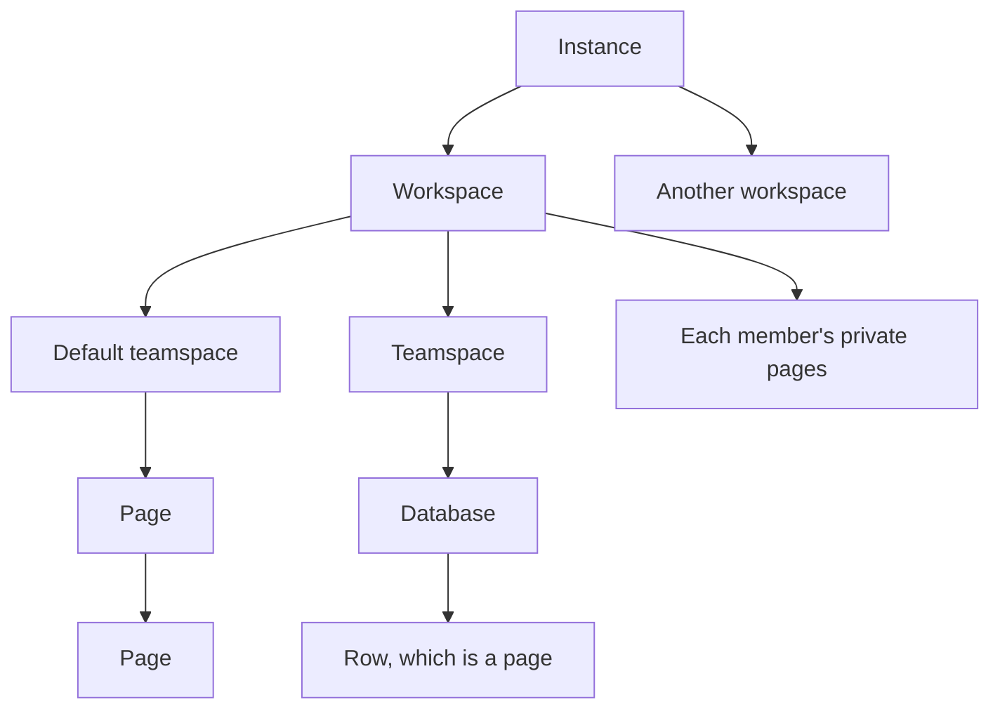

:::note[What is built]
The instance, workspaces, their members and roles, invitations, teamspaces, limits and hues
work, in the API and the web app, as described here, in
[Workspaces and teamspaces](/docs/guides/workspaces/) and in
[Workspace rules and API](/docs/guides/workspace-rules/). Pages work in the API and the web
app: nesting, private pages, sharing, moving, the trash and favorites, and their content in
the live editor, as [Pages](/docs/guides/pages/) and
[Editing pages](/docs/guides/editing-pages/) have it. Their documents sync live over
WebSocket, as [Real-time sync](/docs/architecture/realtime/) has it, and markdown imports as
pages and pages export as markdown, as [Import and export](/docs/guides/import-export/) has
it. Databases work in the API and the web app: their rows, properties and views, the table,
the board and the list, as [Databases](/docs/guides/databases/) and
[Databases and boards](/docs/guides/databases-and-boards/) have it. Agents and integrations
work in the API and the web app, with tokens their owners make or apps connected over
[OAuth](/docs/guides/oauth/), as [Agents](/docs/guides/agents/) has it, over MCP, as
[Agents over MCP](/docs/guides/agents-over-mcp/) has it, and through
[webhooks](/docs/guides/webhooks/) both ways, and pages have comments, mentions and an inbox,
as [Comments and mentions](/docs/guides/comments-and-mentions/) has it, a history, as
[Page history](/docs/guides/history/) has it, search, as [Search](/docs/guides/search/) has
it, and attachments, as [Attachments](/docs/guides/attachments/) has it. What is marked
**planned** is not built yet, the desktop and mobile apps among it. It describes the design
the code is being built toward, so the details may still change.
:::

Content sits in four levels. An **instance** holds **workspaces**, a workspace holds
**teamspaces**, and a teamspace holds **pages**, which nest. A database is a kind of page,
and each of its rows is a page too.

## The instance

An instance is one deployment: the server and its database. Accounts belong to the instance,
not to a workspace, and its admins decide who gets one. Registration is by invite unless they
open it to anyone or close it, so that only admins create accounts.

Instance admins manage accounts, the instance's settings and the limits of each workspace,
and they can delete a workspace. They cannot read one: being an instance admin gives no
access to any workspace, so an admin sees a workspace's name, owners, member count, limits
and usage, and nothing inside it unless they are a member themselves.

Limits cap a workspace's members, storage and agents. Each is unlimited unless an instance
admin sets an instance-wide default or a workspace's own limit. A workspace at its member
limit takes no more invitations or joins, and nobody already in it is removed; one at its
agent limit makes no more agents or incoming webhooks, and one at its storage limit takes no
more uploads. There is no billing.

## Workspaces

A workspace is a team's space, with its own members, teamspaces and pages. Any account can
create one, unless the setting `workspaces.creation` leaves that to instance admins. A
person can be in several workspaces, and a workspace has a slug, unique on the instance, for
its URLs.

Each member has one of four roles:

| Role | What it may do |
|---|---|
| Owner | Everything an admin may, and the workspace itself: deleting it, making owners and transferring ownership. A workspace always has at least one. |
| Admin | Manage the workspace: its members and guests, invitations, invite links and teamspaces, but never an owner. |
| Member | Work in the workspace, join its open teamspaces and create teamspaces, unless the workspace leaves that to owners and admins. |
| Guest | See only the pages shared with them: no teamspace, and no member but themselves. |

Invitations go to accounts that already exist, and never create one. The person invited
accepts or declines, and nothing is joined before they accept. An invite link admits up to a
set number of people until it expires, and only someone signed in: opening it is accepting
it. The [permissions](/docs/reference/permissions/) page lists who may do what.

## Teamspaces

Every workspace has one default teamspace that all its members but guests are in. It cannot
be deleted, left or made private. Other teamspaces are one of three kinds:

| Kind | Who sees it | Who joins it |
|---|---|---|
| Open | Every member | Any member, by joining |
| Closed | Every member | Members its owners add |
| Private | Its own members; the workspace's owners and admins see its name, to manage it | Members its owners add |

A teamspace has owners and members, and keeps at least one owner while its owners manage it.
The workspace's owners and admins manage every teamspace. A private one they are not in,
they know by name alone: they may delete it, or join it to manage it, which its members then
see.

## Pages

Pages nest under other pages. Besides the teamspaces, each member has private pages in
every workspace they are in, which only they see. A page takes its access from its
teamspace: the teamspace's members edit it, and the workspace's other members view it,
unless the teamspace is private. A page can also be shared with a person, who then **can
edit**, **can comment** on or **can view** it and every page under it. [Pages](/docs/guides/pages/) has the
rules.

A page is made of blocks: paragraphs, headings, lists, to-dos, toggles, quotes, code,
tables, images, video, audio and files. Everyone on a page edits the same live document: each sees the others' cursors, and
their edits merge, agents' edits over MCP and the API included. Markdown is the way in and
out: markdown shortcuts work while typing, and pasted markdown becomes blocks. A database
can sit inside a page, its views shown where it was placed. A mention names a person, an
agent or a page inline, and tells the one it names. **Planned:** callouts.

`.md` files or a zip of them import as pages, and a page or a whole teamspace exports as a
zip of markdown files, in the web app and through the API; see
[Import and export](/docs/guides/import-export/).

A page has an icon and a cover, a preset or an image of its own, and a font: Default, Serif
or Mono, with small text or full width. Its images, video, audio and other files are
[attachments](/docs/guides/attachments/), uploaded to it, pasted or dropped in the editor. Members can mark pages as favorites. Trashed pages go to the trash with the
pages under them, where those who could edit them restore them for 30 days unless the
instance keeps them for another time. A page's [history](/docs/guides/history/) keeps
earlier versions to look at and restore, and [search](/docs/guides/search/) finds pages,
databases and rows by the words in them and in their comments.

Comments go on a whole page or on a passage of it, and stay with that passage as the text
around it changes; a passage deleted leaves its thread without a place. Mentions, replies,
comments on the pages a person follows and the rows assigned to them land in their
[inbox](/docs/guides/inbox/), and by mail when they want it.

## Databases and views

A database is a page that holds rows. It is either a page of its own or inline, inside
another page. Each row is a page with **properties** and a body of blocks.
[Databases and boards](/docs/guides/databases-and-boards/) shows them in the web app, and
[Databases](/docs/guides/databases/) has their rules and API.

Properties have a type:

| Type | Holds |
|---|---|
| Title | The row's name, which is its page's title. |
| Text, number, URL, checkbox, date | A value of that kind. |
| Select, multi-select | One or several options from a list. |
| Status | One option from a list of states, such as Not started, In progress and Done, each in a group: to do, in progress or done. |
| Person | People or agents of the workspace. |
| Unique ID | A number with the database's prefix, such as `NW-42`. |
| Created time, created by, edited time, edited by | Kept by the server. |

A database has **views**: a table, a board or a list. Each view keeps its filters, sorts,
grouping and the properties it shows. A board groups the rows into columns by a status, a
select or a person property. A kanban board is a board view grouped by status.

Properties are plain values rather than part of a live document. When two people change the
same property at once, the last change wins, and everyone who has the database open sees it
at once.

## Members

Everyone in a workspace is a member, of one of three kinds:

| Kind | What it is |
|---|---|
| Human | A person with an account on the instance. |
| Agent | A program that acts through MCP or the API, owned by a person. |
| Integration | An incoming webhook, owned by the person who made it. |

Agents and integrations are members rather than a side door: the same permission rules,
limits and attribution hold for them as for people.

## Guests

A guest is a member with the guest role, who sees the pages shared with them, and the pages
under those, and nothing else of the workspace. Guests are how a team lets someone outside
it read or edit a few pages.

## Agents

An agent is a member of kind agent, with an owner, a name and a hue. Its role is always
member, never admin or owner, and it joins teamspaces as a person does. It may do what both
its own access and its owner's allow, never more than the owner. Its work is shown as
`agent name · via owner`, so everyone sees who answers for it. [Agents](/docs/guides/agents/)
has the rules, and the API.

When its owner leaves the workspace, becomes a guest there or has their account disabled,
the agent is suspended.
Agents count toward the workspace's agent limit. Workspace admins can turn agents off for
the workspace, and choose who may create them: admins only, or any member, which is the
default.

Agents connect over MCP at `/mcp` with a token their owner makes for them, bound to the
workspace, with the scope read or write, never doing more than its owner may. Or the
agent's client signs in through its owner's browser with [OAuth 2.1](/docs/guides/oauth/),
where the owner chooses whether it acts as them or as one of their agents. Everything an
agent does over MCP, a script can also do through the HTTP API with the same token;
[Agents over MCP](/docs/guides/agents-over-mcp/) has the tools.

## Integrations

An integration is a member of kind integration, made with an
[incoming webhook](/docs/guides/webhooks/#incoming-webhooks). A workspace owner or admin
creates one with a name and a target: a database, where it creates rows or updates them by
unique ID, or a page, where it appends blocks. It gets a secret address under `/hooks/in/`,
and can also check a signature from senders that sign their requests. It has the same
attribution, permissions and limits as an agent, and joins no teamspace: its access is its
target alone. One for a page may comment on it too.

[Outgoing webhooks](/docs/guides/webhooks/#outgoing-webhooks) go the other way. Workspace
owners and admins register them for anyone in the workspace, and everyone else but guests for
themselves and their own agents and integrations. The server calls them on events for that
identity: being assigned a row, a status change on a row assigned to them, being mentioned,
and a reply to their comment. This is how an agent that runs on its own hears of new work
without polling.

## Hues

Users, workspaces, teamspaces, agents and integrations each get a hue worked out from their
ID, so the same one has the same colour everywhere, with nothing to choose or store. Each can
pin a hue of its own instead. Databases have none yet; theirs is **planned**. A workspace's
hue is also the accent of the app for its members, unless they pick one of their own; see
[The web app](/docs/architecture/web/#the-theme-model).
