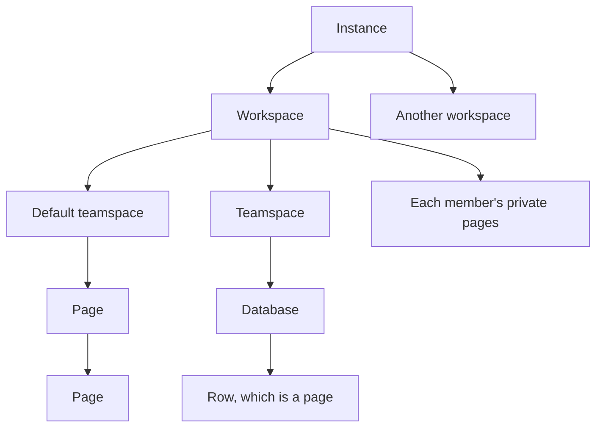

:::note[Planned]
Everything on this page is planned. It describes the design the code is being built toward,
so the details may still change.
:::

Content sits in four levels. An **instance** holds **workspaces**, a workspace holds
**teamspaces**, and a teamspace holds **pages**, which nest. A database is a kind of page,
and each of its rows is a page too.

## The instance

An instance is one deployment: the server and its database. Accounts belong to the instance,
not to a workspace, and its admins decide who gets one. Registration is by invite unless they
open it to anyone or close it, so that only admins create accounts.

Instance admins manage accounts, the instance's settings and the limits of each workspace,
and they can delete a workspace. They cannot read one: the app never opens a workspace's
content for them.

Limits cap a workspace's storage, members and agents. They are unlimited unless an admin
sets them. A workspace at a limit cannot take more uploads or invitations, and its members
go on editing as before. There is no billing.

## Workspaces

A workspace is a team's space, with its own members, teamspaces and pages. Any account can
create one, unless the instance's configuration leaves that to admins. A person can be in
several workspaces and switches between them in the sidebar.

Each member has one of four roles:

| Role | What it may do |
|---|---|
| Owner | Everything an admin may, and the workspace itself is theirs. |
| Admin | Manage the workspace: its members, invitations, teamspaces, agents and webhooks. |
| Member | Work in the teamspaces they are in. |
| Guest | See only the pages shared with them. |

Invitations to a workspace go to accounts that already exist, and never create one. The
person invited accepts or declines. An invite link admits a set number of people until it
expires, and only works for someone signed in.

## Teamspaces

Every workspace has a default teamspace that all its members are in. Other teamspaces are
one of three kinds:

| Kind | Who sees it | Who joins it |
|---|---|---|
| Open | Every member | Any member, by joining |
| Closed | Every member | Members someone invites |
| Private | Its own members only | Members someone invites |

A teamspace has owners and members, and may pin a hue of its own.

## Pages

A page is made of blocks: paragraphs, headings, lists, to-dos, code, callouts, toggles,
mentions and embedded views of a database. Pages nest under other pages. Besides the
teamspaces, each member has private pages in every workspace they are in.

A page takes its access from its teamspace. One page can also be shared with a person, who
**can edit** or **can view** it.

Everyone on a page edits the same live document, people and agents alike: each sees the
others' cursors, and their edits merge. Markdown is the way in and out. Markdown shortcuts
work while typing, pasted markdown becomes blocks, `.md` files or a zip of them can be
imported, and a page or a whole teamspace exports as a zip of markdown files.

A page can have an icon and a cover, and a font: Default, Serif or Mono, with small text or
full width. Members can mark pages as favorites. Deleted pages go to the trash, where they
can be restored for 30 days unless the instance keeps them for another time. A page's
history keeps earlier versions to look at and restore.

Comments go on a whole page or on a passage of it, and stay with that passage as the text
around it changes. Mentions land in the inbox of the person mentioned.

## Databases and views

A database is a page that holds rows. It is either a page of its own or inline, inside
another page. Each row is a page with **properties** and a body of blocks.

Properties have a type:

| Type | Holds |
|---|---|
| Title | The row's name, which is its page's title. |
| Text, number, URL, checkbox, date | A value of that kind. |
| Select, multi-select | One or several options from a list. |
| Status | One option from a list of states, such as To do, In progress, Review, Done. |
| Person | People or agents of the workspace. |
| Unique ID | A number with the database's prefix, such as `NW-42`. |
| Created time, created by, edited time, edited by | Kept by the server. |

A database has **views**: a table, a board or a list. Each view keeps its filters, sorts,
grouping and the properties it shows. A board groups the rows into columns by a status, a
select or a person property. A kanban board is a board view grouped by status.

Properties are plain values rather than part of a live document. When two people change the
same property at once, the last change wins, and everyone who has the database open sees it
at once.

## Members

Everyone in a workspace is a member, and a member is one of three kinds:

| Kind | What it is |
|---|---|
| Human | A person with an account on the instance. |
| Agent | A program that acts through MCP or the API, owned by a person. |
| Integration | An incoming webhook, owned by the person who made it. |

Agents and integrations are members rather than a side door: the same permission rules,
limits and attribution hold for them as for people.

## Guests

A guest is a member with the guest role, who sees the pages shared with them and nothing
else of the workspace. Guests are how a team lets someone outside it read or edit a few
pages.

## Agents

An agent is a member of kind agent, with an owner, a name and a hue. Its role is always
member, never admin or owner, and it joins teamspaces as a person does. It may do what both
its own access and its owner's allow, never more than the owner. Its work is shown as
`agent name · via owner`, so everyone sees who answers for it.

When its owner leaves the workspace or their account is disabled, the agent is suspended.
Agents count toward the workspace's agent limit. Workspace admins can turn agents off for
the workspace, and choose who may create them: admins only, or any member, which is the
default.

Agents connect over MCP at `/mcp`. An agent's client signs in through its owner's browser
with OAuth 2.1, where the owner chooses whether it acts as them or as one of their agents.
Agents that run on their own, with no browser, use a token instead. A token belongs to one
workspace, with the scope read, write or admin, and never does more than its owner's role
allows. Everything an agent does over MCP, a script can also do through the HTTP API with
the same token.

## Integrations

An integration is an incoming webhook. A workspace admin creates one with a name and a
target: a database, where it creates rows or updates them by unique ID, or a page, where it
appends blocks or comments. It gets a secret address under `/hooks/in/`, and can also check a
signature from senders that sign their requests. An integration is a member of kind
integration, so it has the same attribution, permissions and limits as an agent.

Outgoing webhooks go the other way. Workspace admins and agents' owners register them, and
the server calls them on events for a member: being assigned, being mentioned, a reply to
their comment, or a status change on a row assigned to them. This is how an agent that runs
on its own hears of new work without polling.

## Hues

Users, agents, integrations, teamspaces, workspaces and databases each get a hue worked out
from their ID, so the same one has the same colour everywhere, with nothing to choose or
store. Each person also picks an accent hue for the app; see
[The web app](/docs/architecture/web/#the-theme-model).
