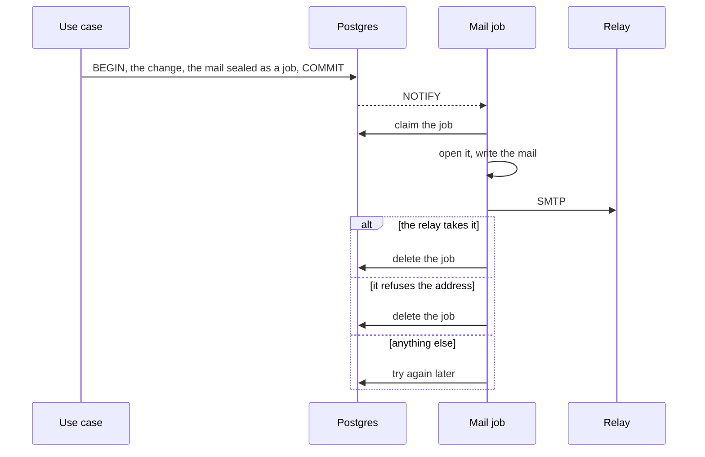

The server sends mail for accounts: links that verify an address, set a new password or
confirm a request to join, notices of a changed password or a denied request, invites, a
note to admins about each request waiting for them, a test, and, once an admin turns it on,
the mail of people's [inboxes](/docs/guides/inbox/#notification-mail). It hands every mail to an
SMTP server you choose, a **relay**, which delivers it. The server never delivers to the
recipients' mail servers itself.

## What mail needs

Mail goes out once all four hold:

1. `mail.enabled` is on.
2. `mail.host` and `mail.from` are set.
3. `secrets.keys` holds a key: a queued mail can carry a link that works once, so it waits
   in the queue sealed. See [Secret keys](/docs/self-hosting/configuration/#secret-keys).
4. `server.public_url` is set, as the links point there.

Until then, the flows that need mail are off, and `GET /api/v1/auth/config` reports them
off: verifying sign-ups, password resets, mailed invites and requests to join. The settings
refuse `auth.verify_email` and `auth.requests` while mail is not set up, since either would
turn people away unseen. `GET /api/v1/admin/settings` carries the mail status: whether mail
can go, and what is missing when it cannot.

## The settings

Mail is configured with [runtime settings](/docs/reference/settings/), so admins can change
it without a restart, and the server reads them again for every mail.

| Setting | Default | What it sets |
|---|---|---|
| `mail.enabled` | `false` | Sends mail through the server below. |
| `mail.host` | empty | The SMTP server's host name or IP address, such as `smtp.example.com`, without a scheme or port. |
| `mail.port` | `587` | Its port: 587 for `starttls`, 465 for `tls`, 25 or the relay's own for `none`. |
| `mail.tls` | `starttls` | How the connection is secured; see [TLS](#tls). |
| `mail.username` | empty | The account to sign in with. Empty for a relay that takes mail without signing in. |
| `mail.password` | empty | Its password, a secret setting: kept sealed, and saved only while `secrets.keys` is set. |
| `mail.from` | empty | The address mail comes from, such as `neon@example.com`. The relay must let the account send as it. |
| `mail.from_name` | empty | The name beside it. Empty uses `instance.name`. |
| `mail.notifications` | `true` | Mails admins about each confirmed request to join. Off, they see requests on the admin page only. |

The password, and the settings that say where it goes, `mail.host`, `mail.port`, `mail.tls`
and `mail.username`, change only from a browser session. An API token, even an admin's
with the `admin` scope, is refused with `403`: a token that leaked could otherwise send the
password, and every reset link, to a server of its holder's choosing.

Set in the environment or in `neon.yaml`, a setting is pinned, and the admin page cannot
change it. A deployment that manages mail itself might set:

```sh
NEON_SERVER__PUBLIC_URL=https://neon.example.com
NEON_SECRETS__KEYS=2026:<output of openssl rand -base64 32>
NEON_SETTINGS__MAIL__ENABLED=true
NEON_SETTINGS__MAIL__HOST=smtp.example.com
NEON_SETTINGS__MAIL__USERNAME=neon@example.com
NEON_SETTINGS__MAIL__PASSWORD=<the relay's password for it>
NEON_SETTINGS__MAIL__FROM=neon@example.com
```

## TLS

`mail.tls` takes three values:

- `starttls` connects in plain text and upgrades with STARTTLS before anything else is sent.
  A server that does not offer STARTTLS is refused, rather than written to in the clear.
  This is the usual mail submission port, 587.
- `tls` speaks TLS from the first byte, as on port 465.
- `none` stays plain. It suits a relay on the same host, or on a network you trust, such
  as Mailpit in development.

With TLS, the version is 1.2 or later and the server's certificate is always checked,
against the Mozilla root certificates built into the server. A self-signed certificate is
refused; put the relay behind a certificate from a public CA, such as Let's Encrypt.

A password never crosses the network in the clear: with `mail.tls` set to `none` and a
username, the settings refuse any host but this one, `localhost` or a loopback address.

## How mail is sent



- A mail is queued in the same transaction as the change it tells of, so a change that rolls
  back sends nothing, and one that commits always has its mail queued.
- The job, of kind `mail.send`, holds the mail sealed with the [secret key](/docs/self-hosting/configuration/#secret-keys)
  and bound to the job's row, recipient and link included. It is deleted as soon as it
  finishes, sent or given up on, so the database never keeps a link in the clear, nor a
  finished mail at all.
- The job writes the mail as it runs, with the instance's name and the From settings of
  that moment: a plain text part, and an HTML part in the app's look with the link as a
  button. Each mail has a `Message-ID` on the From address's domain and
  `Auto-Submitted: auto-generated`, so auto-responders leave it be.
- A relay that refuses the recipient or the mail for good, with a `55x` answer, ends the
  job at once. A link that expired while its mail waited is dropped unsent. Anything else,
  such as a relay that cannot be reached or refuses the sign-in, is tried again after a
  delay that starts at 10 seconds and doubles each time, ten tries in all, over at most an
  hour and a half.
- Logs name the kind of mail, such as `password_reset`, never the recipient or the link. A
  relay's answer often names the recipient, as in `550 5.1.1 <bob@example.com>: Recipient
  address rejected`, so every address in it is replaced by `[address]` before it is logged
  or kept.

The links in mail open the app's pages, at `server.public_url`:

| Mail | Link |
|---|---|
| Verification | `/verify?token=…` |
| Password reset | `/reset?token=…` |
| Password changed | `/reset`, to ask for a reset link |
| Invite | `/register?invite=…` |
| Request to join, confirmation | `/join/confirm?token=…` |
| Request to join, for admins | `/admin/join-requests` |
| A notification | `/w/<workspace>/p/<page>?comment=…`, or `?block=…`, the page at what it is about; `/inbox` for an invitation |
| A digest | Each notification's, and `/inbox` |
| Stopping notification mail | `/unsubscribe?token=…` |

[Notification mail](/docs/guides/inbox/#notification-mail), of each notification or a
digest, goes only while `notifications.mail` is on, and its own job, `notifications.mail`,
writes each one's `mail.send` job once it has waited `notifications.mail_delay` unread. Such
mail carries `List-Unsubscribe`, the API's address that stops it, and
`List-Unsubscribe-Post: List-Unsubscribe=One-Click`, so mail clients offer their own button,
as large providers expect of mail sent in bulk.

## Sending a test

`POST /api/v1/admin/mail/test` queues a test mail to the admin who calls it, and answers
`202` once it is queued, or `409` with what is missing while mail cannot go. Whether the
relay took it shows in the inbox, and in the mail status of `GET /api/v1/admin/settings`:
`last_sent_at`, and `last_failure` with what the relay answered when it did not, its
addresses redacted. The status covers deliveries since the server started.

## A relay

Any SMTP server that takes mail for your domain works.

- **A mail service.** Most transactional mail services, and most mailbox providers, take
  mail on port 587 with STARTTLS and a username and password, often one made for the
  application. They sign the mail and send it from addresses with a good reputation, which
  is the easiest way to mail that arrives.
- **[Stalwart](https://stalw.art/)**, a mail server you run yourself. Make the domain and an
  account for the server's From address in its admin interface, which generates the DKIM
  key and lists the DNS records to publish. Point `mail.host` at it, with port 587,
  `starttls`, and the account's name and password. Stalwart then delivers to the
  recipients' servers on port 25, so it needs what the next section describes.

Run on the same host as the server, a relay can be reached with `mail.tls` set to `none`
on `localhost`. Across a network, use `starttls` or `tls`.

## Deliverability

Mail servers decide whether to trust mail by the DNS of the domain it claims to come from,
`mail.from`'s, and of the machine that delivered it. A mail service covers the machine's
part and tells you the records for the domain's. A relay you run needs all of these:

- **Port 25 open outbound.** Servers deliver to each other on port 25. Many VPS and cloud
  providers block it outbound, often for new accounts, some lifting the block on request,
  some never. Check before you set a relay up there. When it stays blocked, have the relay
  pass its mail on to a mail service, a smarthost, on port 587. The server itself only
  needs to reach the relay, on 587 or 465 as a rule.
- **PTR.** The reverse DNS of the relay's IP address names the relay, such as
  `mail.example.com`, and that name resolves back to the same address. Providers set it in
  their control panel, not in your DNS zone. Many receivers refuse mail from an address
  without one.
- **SPF.** A TXT record on the From domain lists who may send for it, such as
  `v=spf1 mx -all`, or the `include:` a mail service gives you.
- **DKIM.** The relay signs each mail, and a TXT record at `<selector>._domainkey` on the
  domain publishes the key that checks the signature. The relay, or the mail service, gives
  the record.
- **DMARC.** A TXT record at `_dmarc` on the domain tells receivers what to do with mail that
  fails SPF and DKIM for the From domain, and where to send reports. Start with `p=none`, to
  see reports before anything is refused, then move to `quarantine` or `reject`:

  ```text
  _dmarc.example.com.  TXT  "v=DMARC1; p=none; rua=mailto:dmarc@example.com"
  ```

To check, send a test mail to a mailbox at a large provider and read the message's headers:
`Authentication-Results` should show `spf=pass`, `dkim=pass` and `dmarc=pass`.

## Development

The development Compose file runs [Mailpit](https://mailpit.axllent.org), which takes every
mail and shows it in a browser. `make db-up` starts it with Postgres: SMTP on
`127.0.0.1:51025`, without TLS or a password, and the inbox at `http://127.0.0.1:58025/`.
Neither is Mailpit's usual port, so a Mailpit already running does not clash. Its mail is
kept in memory, so restarting it empties the inbox.

`.env.example` ends with the settings that send the server's mail there, commented out.
Uncomment them, add a secret key, and run `make run`:

```sh
NEON_SERVER__PUBLIC_URL=http://localhost:5173
NEON_SECRETS__KEYS=dev:<output of openssl rand -base64 32>
NEON_SETTINGS__MAIL__ENABLED=true
NEON_SETTINGS__MAIL__HOST=127.0.0.1
NEON_SETTINGS__MAIL__PORT=51025
NEON_SETTINGS__MAIL__TLS=none
NEON_SETTINGS__MAIL__FROM=neon@example.com
```

The public URL is the web app's development server, so links open its pages. With it set,
browsers must reach the server through `make web-dev`, as requests that change something
must come from that origin.

In the Docker stack, the `mail` profile runs Mailpit at `mailpit:1025` inside the stack's
network, with its inbox on `http://127.0.0.1:8025/`; see
[Profiles](/docs/self-hosting/install/#profiles). Point the server
at it in `deployments/server.env`, with host `mailpit`, port `1025` and TLS `none`.

## When mail does not arrive

- **Mail cannot go.** The mail status in `GET /api/v1/admin/settings` says what is missing,
  and the server logs it as it starts.
- **The relay refused it.** `last_failure` in the mail status holds what the relay answered:
  a `535` is a wrong username or password; a certificate error means the relay's certificate
  is self-signed or names another host; `STARTTLS` not offered means it wants `none` on
  another port, or `tls`. A connection that times out is often a port blocked between the
  two. The server's log has a line for every mail sent and every failure, by kind.
- **It went to spam, or nowhere.** The relay took it, so the receiving side decided: see
  [Deliverability](#deliverability), and the relay's own logs.

Mail jobs are deleted when they finish, so there is no dead job to look at afterwards: the
log and the mail status keep the reason.
